# Sprint 10 – DevOps Capstone Project

## 1. Project Overview

This project implements a three-tier microservice application deployed on a local Kubernetes cluster using Minikube.

The application consists of:
- **Frontend:** React application served using NGINX.
- **Backend:** Go REST API.
- **Database:** PostgreSQL deployed using a StatefulSet with persistent storage.

The project demonstrates containerization, Kubernetes deployments, service discovery, persistent storage, autoscaling, Ingress routing, NetworkPolicy enforcement, and Kustomize-based configuration management.

## 2. Architecture

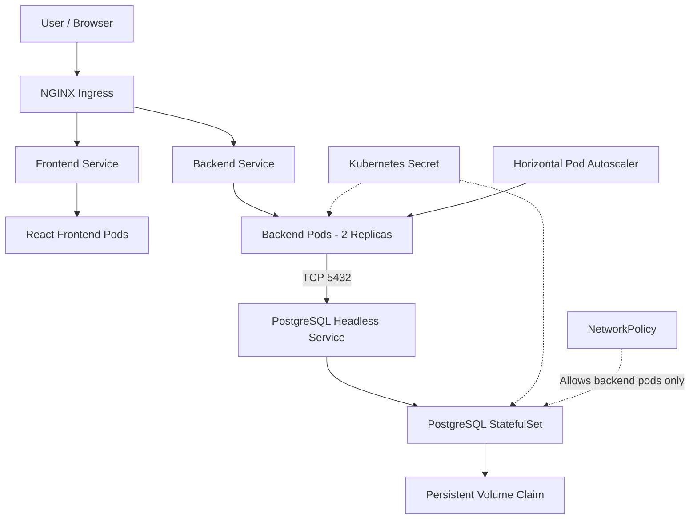

## 3. Technologies Used

| Technology | Purpose |
|---|---|
| React + Vite | Frontend application |
| NGINX | Frontend web server |
| Go | Backend REST API |
| PostgreSQL | Persistent database |
| Docker | Containerization |
| Kubernetes | Container orchestration |
| Minikube | Local Kubernetes cluster |
| Calico | Container networking and NetworkPolicy enforcement |
| Kustomize | Kubernetes manifest management |
| NGINX Ingress | External application access |
| Metrics Server | Resource metrics for HPA |

## 4. Project Structure

```text
sprint-10/
├── README.md
├── Screenshots/
│   ├── 01-kubernetes-resources.png
│   ├── 02-postgresql-statefulset.png
│   ├── 03-pvc-storage.png
│   ├── 04-backend-deployment.png
│   ├── 05-hpa-autoscaling.png
│   ├── 06-frontend-deployment.png
│   ├── 07-ingress-routing.png
│   ├── 08-web-application.png
│   ├── 09-backend-api-status.png
│   ├── 10-kustomize-output.png
│   └── 11-networkpolicy-configuration.png
├── frontend/
│   ├── Dockerfile
│   └── application/
├── backend/
│   ├── Dockerfile
│   └── application/
├── kubernetes/
│   ├── database/
│   │   ├── pvc.yaml
│   │   ├── service.yaml
│   │   ├── statefulset.yaml
│   │   └── kustomization.yaml
│   ├── backend/
│   │   ├── deployment.yaml
│   │   ├── service.yaml
│   │   ├── hpa.yaml
│   │   └── kustomization.yaml
│   ├── frontend/
│   │   ├── deployment.yaml
│   │   ├── service.yaml
│   │   └── kustomization.yaml
│   ├── ingress.yaml
│   ├── network-policy.yaml
│   └── kustomization.yaml
└── argocd/
    └── application.yaml
```

**Security note:** The Kubernetes database Secret is intentionally excluded from Git and Kustomize. It must be created separately in the cluster.

## 5. Application Features

### Frontend
- React-based user interface.
- Image upload functionality.
- Image gallery display.
- Image retrieval and deletion.
- Served through an unprivileged NGINX container.

### Backend
- Go REST API.
- PostgreSQL database connectivity.
- Image upload and storage.
- Image retrieval and deletion.
- Health and readiness endpoints.

### Database
- PostgreSQL StatefulSet.
- Persistent Volume Claim for database storage.
- Kubernetes Secret for database credentials.
- Headless Service for stable database discovery.

## 6. Kubernetes Components

### PostgreSQL StatefulSet

- StatefulSet: `capstone-postgres`
- Replicas: 1
- Image: `postgres:17-alpine`
- Service: `capstone-postgres-service`
- PVC: `capstone-postgres-pvc`
- Storage: 5Gi
- Access mode: ReadWriteOnce

Database credentials are supplied through the Kubernetes Secret:

`capstone-postgres-secret`

### Backend Deployment

- Deployment: `capstone-backend`
- Replicas: 2
- Container port: 3000
- Service: `capstone-backend-service`
- CPU and memory requests and limits configured.
- Liveness and readiness probes configured.
- Non-root container execution configured.

### Frontend Deployment

- Deployment: `capstone-frontend`
- Replicas: 2
- Service: `capstone-frontend-service`
- Container port: 8080
- NGINX unprivileged image.
- Resource limits and health checks configured.
- Container security settings configured.

### Horizontal Pod Autoscaler

- HPA: `capstone-backend-hpa`
- Minimum replicas: 2
- Maximum replicas: 5
- Target CPU utilization: 50%

Metrics Server provides resource metrics for autoscaling.

### Ingress

- Ingress: `capstone-ingress`
- Host: `capstone.local`
- Controller: NGINX Ingress Controller

Routing rules:

| Path | Destination |
|---|---|
| `/` | Frontend Service |
| `/api` | Backend Service |

Application URL:

`http://capstone.local:8088`

The local port 8088 is exposed through a Kubernetes port-forward.

### NetworkPolicy

Policy name: `capstone-database-policy`

The policy selects PostgreSQL pods and allows incoming TCP traffic on port 5432 only from pods carrying:

```yaml
tier: backend
```

NetworkPolicy enforcement was tested on a separate Minikube cluster using Calico CNI.

The backend test pod could connect to PostgreSQL, while the frontend test pod was blocked.

**Note:** The original Minikube cluster uses kindnet, which does not enforce Kubernetes NetworkPolicies. Calico was used for the enforcement test.

## 7. Deployment Instructions

### Prerequisites

Install and configure:

- Docker
- Minikube
- kubectl
- Kustomize support through kubectl
- A Kubernetes cluster with a compatible CNI

### Step 1: Start Minikube

```bash
minikube start -p sprint10-calico
```

Select the correct Kubernetes context:

```bash
kubectl config use-context sprint10-calico
```

Check cluster status:

```bash
kubectl get nodes
```

### Step 2: Build Docker Images

From the project root:

```bash
cd ~/Devops-Intership-2026/sprint-10
```

Build the backend image:

```bash
docker build -t capstone-backend:1.0 ./backend
```

Build the frontend image:

```bash
docker build -t capstone-frontend:1.0 ./frontend
```

Make sure both images are available to the Minikube cluster before deploying.

For a Docker-driver Minikube cluster, images can be loaded using:

```bash
minikube image load capstone-backend:1.0 -p sprint10-calico
minikube image load capstone-frontend:1.0 -p sprint10-calico
```

### Step 3: Create the Database Secret

Create the Secret separately. Do not commit passwords or Secret YAML files to Git.

The Secret must contain these keys:

- `POSTGRES_DB`
- `POSTGRES_USER`
- `POSTGRES_PASSWORD`

Expected Secret name:

`capstone-postgres-secret`

### Step 4: Deploy Kubernetes Resources

Apply the Kustomize configuration:

```bash
kubectl apply -k kubernetes/
```

### Step 5: Enable Required Minikube Add-ons

```bash
minikube addons enable ingress -p sprint10-calico
minikube addons enable metrics-server -p sprint10-calico
```

### Step 6: Verify Deployment

```bash
kubectl get pods
kubectl get services
kubectl get deployments
kubectl get statefulsets
kubectl get pvc
kubectl get hpa
kubectl get ingress
kubectl get networkpolicy
```

### Step 7: Access the Application

Start the Ingress port-forward:

```bash
kubectl port-forward --address 0.0.0.0 -n ingress-nginx service/ingress-nginx-controller 8088:80
```

Keep this terminal running.

Configure `capstone.local` to resolve to the appropriate host address for your environment.

Open the application:

`http://capstone.local:8088`

## 8. API Endpoints

| Method | Endpoint | Description |
|---|---|---|
| GET | `/health` | Backend liveness check |
| GET | `/ready` | Backend readiness check |
| GET | `/api/status` | Application and database status |
| POST | `/api/images` | Upload an image |
| GET | `/api/images` | Retrieve image list |
| GET | `/api/images/{id}` | Retrieve an image |
| DELETE | `/api/images/{id}` | Delete an image |

### Test Backend API

```bash
curl -i -H "Host: capstone.local" http://127.0.0.1:8088/api/status
```

Expected response:

```json
{
  "application": "DevOps Capstone",
  "backend": "Running",
  "database": "Connected"
}
```

## 9. Kustomize

Kustomize is used to organize and deploy Kubernetes manifests.

The root configuration combines the database, backend, frontend, Ingress, HPA, and NetworkPolicy resources.

View the generated configuration:

```bash
kubectl kustomize kubernetes/
```

Apply the configuration:

```bash
kubectl apply -k kubernetes/
```

The database Secret is managed separately and is not included in the Kustomize output.

## 10. NetworkPolicy Verification

The NetworkPolicy was tested on the Calico-enabled Minikube cluster.

Expected behavior:

| Source Pod | Destination | Expected Result |
|---|---|---|
| Backend (`tier: backend`) | PostgreSQL TCP 5432 | Allowed |
| Frontend (`tier: frontend`) | PostgreSQL TCP 5432 | Blocked |

This verifies that database access is restricted to backend pods.

## 11. Screenshot Evidence

The following screenshots document the Kubernetes deployment and verification.

### 01 – Kubernetes Resources

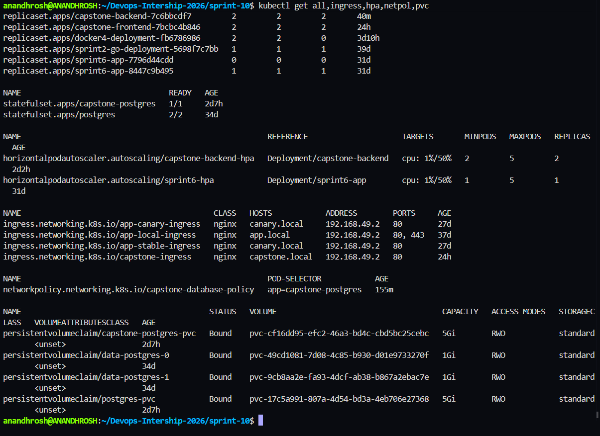

### 02 – PostgreSQL StatefulSet

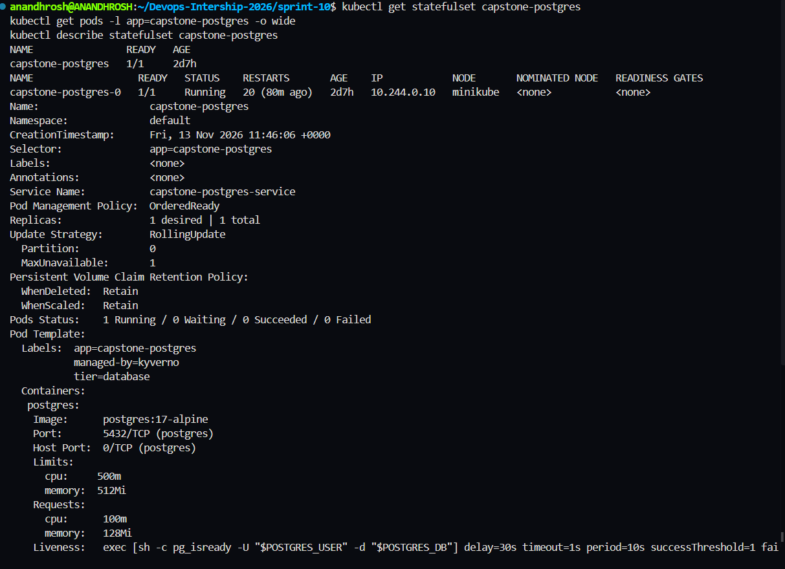

### 03 – Persistent Volume Claim

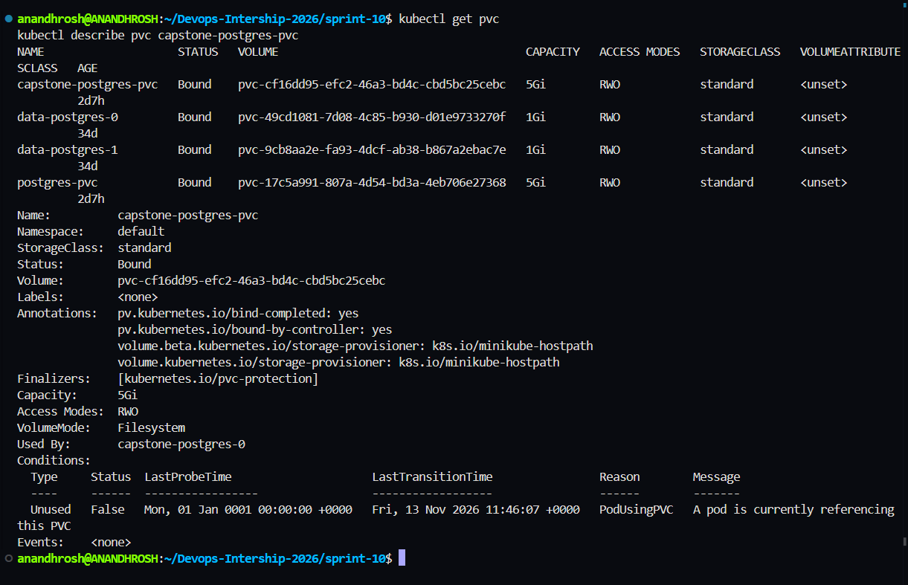

### 04 – Backend Deployment

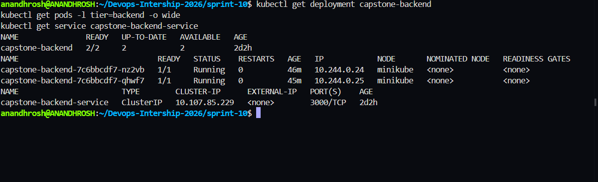

### 05 – HPA Autoscaling

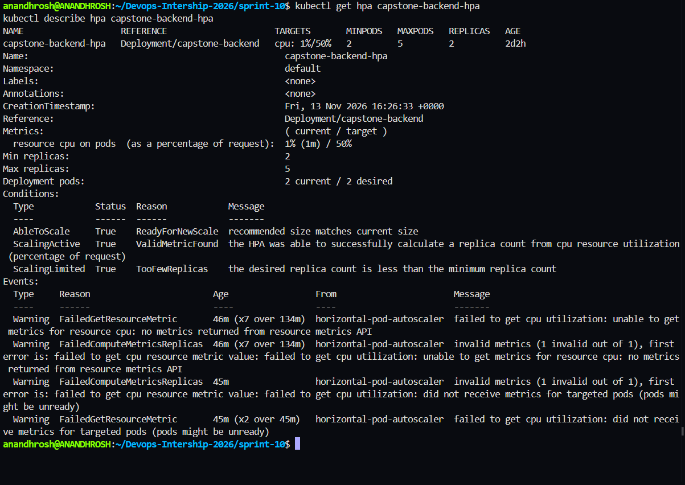

### 06 – Frontend Deployment

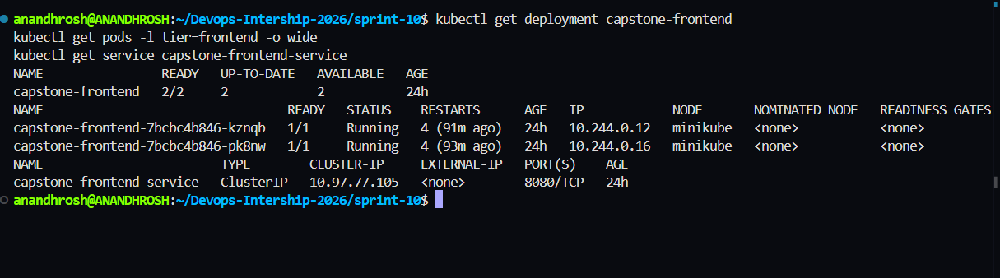

### 07 – Ingress Routing

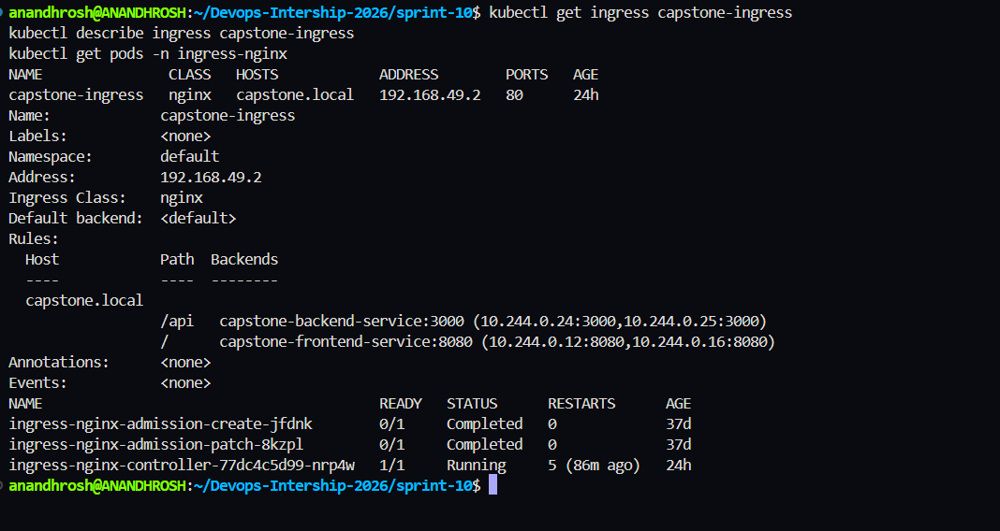

### 08 – Web Application

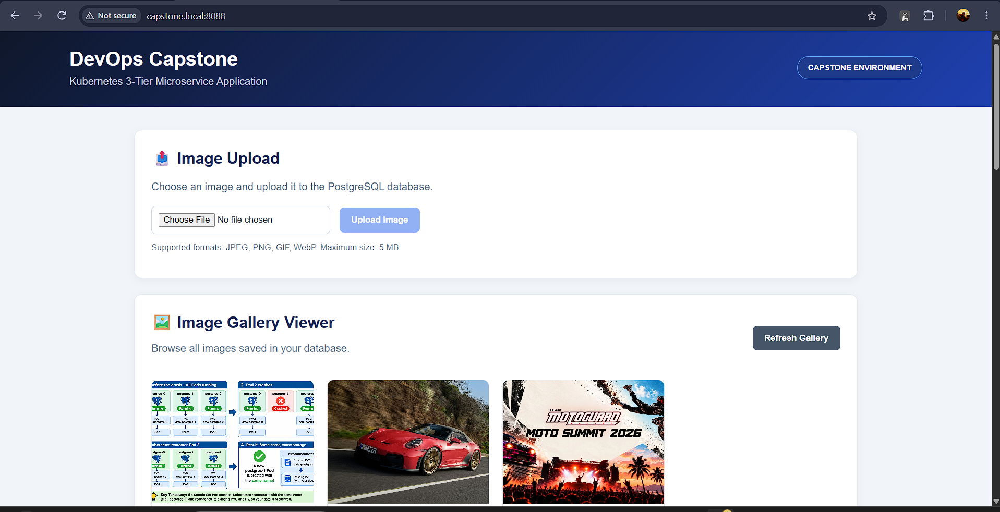

### 09 – Backend API Status

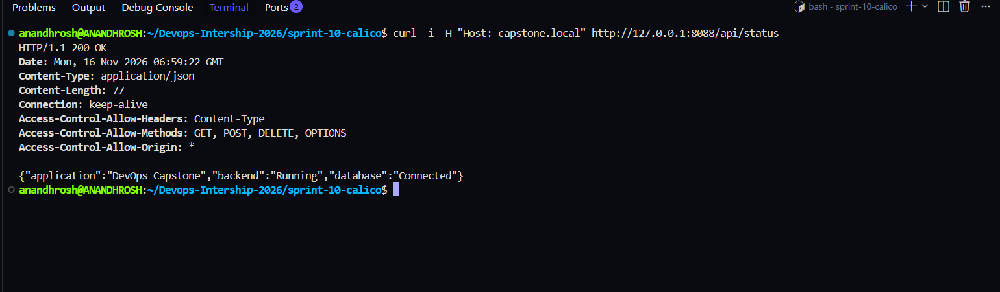

### 10 – Kustomize Output

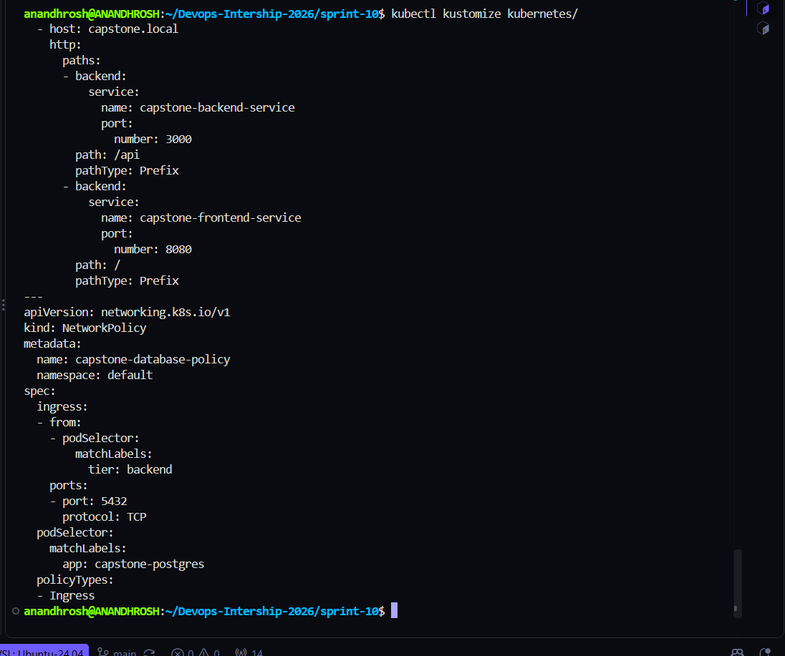

### 11 – NetworkPolicy Configuration

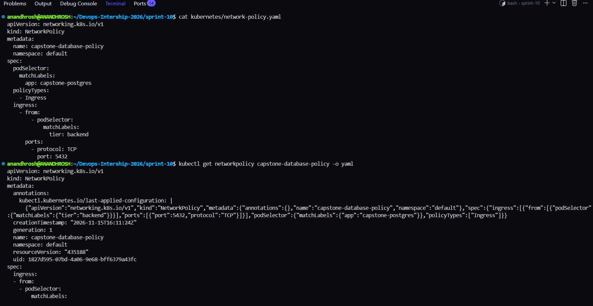

## 12 - NetworkPolicy Frontend Access Blocked

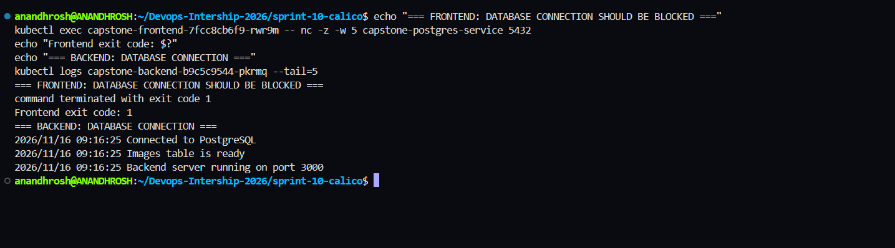

The screenshot demonstrates that the frontend pod cannot connect directly to PostgreSQL on port 5432, while backend logs confirm a successful database connection. This verifies that the Calico NetworkPolicy restricts database ingress to backend pods labelled `tier: backend`.

## 12. Project Verification

The following functionality has been tested:

- React frontend deployed and accessible through Ingress.
- Backend API deployed with two replicas.
- Backend successfully connected to PostgreSQL.
- PostgreSQL StatefulSet running with persistent storage.
- Image upload, retrieval, and deletion functionality tested.
- HPA configured and metrics verified.
- Ingress routing tested.
- Kustomize configuration rendered and applied.
- NetworkPolicy enforcement tested using Calico.

## 13. GitOps Status

An ArgoCD Application manifest has been prepared under:

`argocd/application.yaml`

However, ArgoCD installation and synchronization have not yet been completed.

Therefore, GitOps synchronization is a pending task and is not claimed as verified in this project.

## 14. Security Practices

- Database credentials are stored in Kubernetes Secrets.
- Secret files containing credentials are excluded from Git.
- Previously exposed credentials were rotated.
- Backend and frontend containers use non-root execution.
- Container security contexts and resource limits are configured.
- NetworkPolicy restricts access to PostgreSQL.
- Kubernetes manifests are maintained separately from sensitive credentials.

## 15. Conclusion

This capstone project demonstrates a three-tier application deployed on Kubernetes using React, Go, PostgreSQL, Docker, Minikube, and Kustomize.

It covers application deployment, service discovery, persistent database storage, health checks, autoscaling, Ingress routing, container security, and network isolation.

Calico was used to verify NetworkPolicy enforcement. ArgoCD-based GitOps synchronization remains pending.