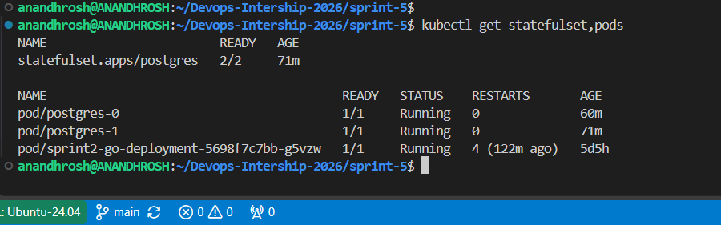
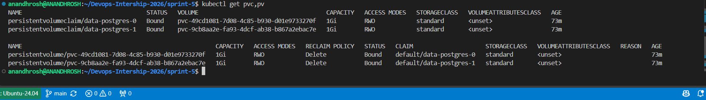
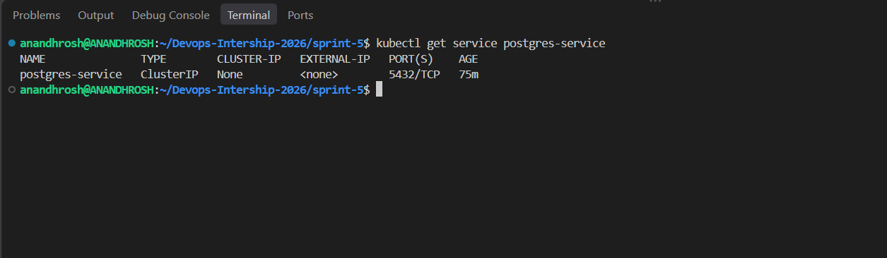
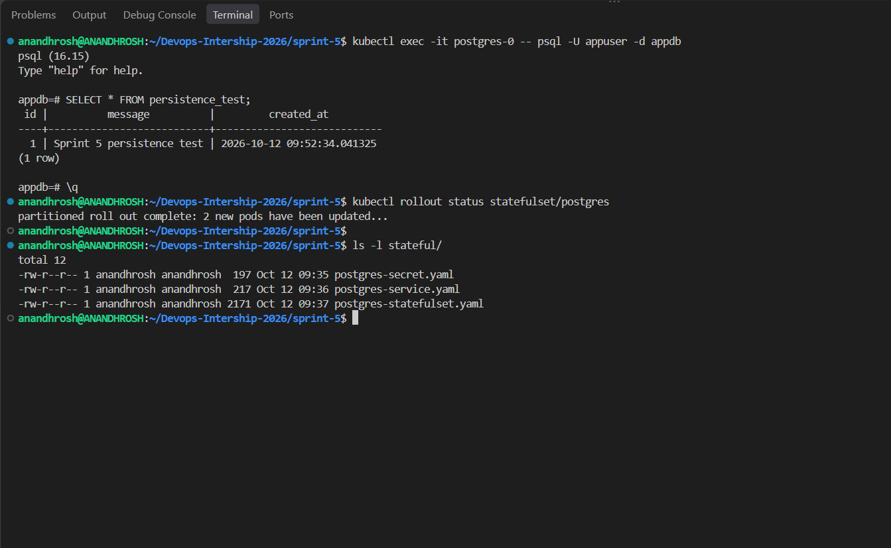

# Sprint 5: Kubernetes StatefulSets & Persistent Storage

## Project Title

**Kubernetes StatefulSets & Persistent Storage**

## Description

This project demonstrates how to deploy PostgreSQL on Kubernetes using a StatefulSet and persistent storage.

The project deploys two PostgreSQL pod replicas using the `postgres:16-alpine` container image. A Headless Service provides stable network identities, while `volumeClaimTemplates` creates a separate PersistentVolumeClaim (PVC) for each pod.

A Kubernetes Secret stores the PostgreSQL username, password, and database name. The database uses persistent storage to retain its data when a pod is deleted and recreated.

The project runs on Minikube using the `standard` StorageClass. A test record is inserted into PostgreSQL, the `postgres-0` pod is deleted, and the record is queried again after Kubernetes recreates the pod.

**Note:** Each PostgreSQL pod has its own database instance and persistent volume. This project demonstrates storage persistence, not automatic PostgreSQL database replication.

## Project Objectives

- Deploy PostgreSQL using a Kubernetes StatefulSet.
- Configure two PostgreSQL pod replicas.
- Create persistent storage using `volumeClaimTemplates`.
- Create a Headless Service using `clusterIP: None`.
- Store database credentials in a Kubernetes Secret.
- Configure PostgreSQL health probes.
- Verify that PersistentVolumeClaims and PersistentVolumes are bound.
- Test data persistence after deleting and recreating a PostgreSQL pod.
- Document the implementation using terminal logs and screenshots.

## Getting Started

### Dependencies

Ensure the following tools are available in your Ubuntu/WSL environment:

- Docker Desktop with WSL integration
- Ubuntu on WSL
- Minikube
- kubectl
- PostgreSQL client (`psql`, available inside the PostgreSQL container)
- Git

### Installing

1. Open the Ubuntu terminal and move to the repository:

   ```bash
   cd ~/Devops-Intership-2026
   ```

2. Start Minikube:

   ```bash
   minikube start
   ```

3. Confirm that the Kubernetes node is ready:

   ```bash
   kubectl get nodes
   ```

   Expected result: the Minikube node should show `Ready`.

4. Verify that a default StorageClass exists:

   ```bash
   kubectl get storageclass
   ```

   The `standard` StorageClass should be available and configured as the default storage class in this lab.

## Executing Program

### 1. Create the Sprint 5 directory

```bash
mkdir -p sprint-5/stateful
mkdir -p sprint-5/Screenshots
cd sprint-5
```

### 2. Configure PostgreSQL credentials

The file `stateful/postgres-secret.yaml` contains the Kubernetes Secret configuration.

The Secret provides the following environment variables to the PostgreSQL container:

- `POSTGRES_USER`
- `POSTGRES_PASSWORD`
- `POSTGRES_DB`

Apply the Secret:

```bash
kubectl apply -f stateful/postgres-secret.yaml
```

Verify the Secret:

```bash
kubectl get secret postgres-secret
kubectl describe secret postgres-secret
```

The Secret should exist in the `default` namespace. Do not print or commit production credentials.

### 3. Create the Headless Service

The file `stateful/postgres-service.yaml` defines the Headless Service named `postgres-service`.

Its configuration uses `clusterIP: None` and exposes PostgreSQL on port `5432`.

Apply the Service:

```bash
kubectl apply -f stateful/postgres-service.yaml
```

Verify the Service:

```bash
kubectl get service postgres-service
```

Expected result: the Service type should be `ClusterIP`, its cluster IP should show `None`, and its port should be `5432/TCP`.

### 4. Deploy the PostgreSQL StatefulSet

The file `stateful/postgres-statefulset.yaml` defines the PostgreSQL StatefulSet.

The configuration includes:

- StatefulSet name: `postgres`
- Container image: `postgres:16-alpine`
- Replicas: 2
- Service name: `postgres-service`
- Storage per pod: 1 GiB
- Storage access mode: `ReadWriteOnce`
- Storage class: `standard`
- Startup, readiness, and liveness probes

Apply the manifest:

```bash
kubectl apply -f stateful/postgres-statefulset.yaml
```

Wait for the StatefulSet rollout:

```bash
kubectl rollout status statefulset/postgres --timeout=180s
```

### 5. Verify the StatefulSet and pods

Run:

```bash
kubectl get statefulset,pods
```

Expected result:

- StatefulSet `postgres` has two ready replicas.
- Pod `postgres-0` is running.
- Pod `postgres-1` is running.

The StatefulSet assigns stable pod names and manages the creation and replacement of its pods.

### 6. Verify PersistentVolumeClaims and PersistentVolumes

Run:

```bash
kubectl get pvc,pv
```

Expected result:

- `data-postgres-0` is `Bound`.
- `data-postgres-1` is `Bound`.
- Each PVC has a capacity of `1Gi`.
- Each PVC is connected to its own PersistentVolume.

The StatefulSet uses `volumeClaimTemplates` to create a separate PVC for each replica.

### 7. Verify the Headless Service endpoints

Run:

```bash
kubectl get service postgres-service
kubectl get endpointslice -l kubernetes.io/service-name=postgres-service
```

The Service should have `CLUSTER-IP` set to `None`. The EndpointSlice should list the ready PostgreSQL pod endpoints.

### 8. Insert a test record into PostgreSQL

Connect to `postgres-0`:

```bash
kubectl exec -it postgres-0 -- psql -U appuser -d appdb
```

Create a table:

```sql
CREATE TABLE persistence_test (
    id SERIAL PRIMARY KEY,
    message TEXT NOT NULL,
    created_at TIMESTAMP DEFAULT CURRENT_TIMESTAMP
);
```

Insert a test record:

```sql
INSERT INTO persistence_test (message)
VALUES ('Sprint 5 persistence test');
```

Query the table:

```sql
SELECT * FROM persistence_test;
```

Expected result: one record with the message `Sprint 5 persistence test`.

Exit the PostgreSQL prompt:

```sql
\q
```

### 9. Delete the PostgreSQL pod

Delete only `postgres-0`:

```bash
kubectl delete pod postgres-0
```

Do not delete the StatefulSet or PVC.

The StatefulSet controller should recreate `postgres-0` and reconnect it to the existing `data-postgres-0` claim.

### 10. Wait for the pod to become ready

Run:

```bash
kubectl wait --for=condition=Ready pod/postgres-0 --timeout=180s
```

Verify the recreated pod and persistent storage:

```bash
kubectl get pods
kubectl get pvc
```

Expected result: `postgres-0` returns to the `Running` state, and `data-postgres-0` remains `Bound`.

### 11. Verify data persistence

Reconnect to the recreated PostgreSQL pod:

```bash
kubectl exec -it postgres-0 -- psql -U appuser -d appdb
```

Run the query again:

```sql
SELECT * FROM persistence_test;
```

The original record should still be present:

```text
 id |          message          |         created_at
----+---------------------------+----------------------------
  1 | Sprint 5 persistence test | 2026-10-12 09:52:34.041325
(1 row)
```

Exit PostgreSQL:

```sql
\q
```

**Result: PASSED.** The record remained available after the pod was deleted and recreated, demonstrating persistence through the existing PVC.

### 12. Final verification commands

Run the following commands from `sprint-5`:

```bash
kubectl get statefulset,pods
kubectl get pvc,pv
kubectl get service postgres-service
kubectl rollout status statefulset/postgres
ls -l stateful/
ls -lh Screenshots/
```

## Technical Explanation

### What is a StatefulSet?

A StatefulSet is a Kubernetes workload resource designed for applications that need stable identities and persistent storage.

Unlike ordinary interchangeable replicas, StatefulSet pods have predictable names and identities. In this project, the pod names are `postgres-0` and `postgres-1`.

### What is a PersistentVolume (PV)?

A PersistentVolume is a storage resource available to a Kubernetes cluster. In this Minikube lab, the `standard` StorageClass dynamically provisions volumes using the Minikube host-path provisioner.

### What is a PersistentVolumeClaim (PVC)?

A PersistentVolumeClaim is a request for storage by an application. Each PostgreSQL replica receives its own 1 GiB PVC through the StatefulSet's `volumeClaimTemplates`.

When `postgres-0` is recreated, Kubernetes reconnects it to its existing PVC, allowing the database to access its previous files.

### What is a Headless Service?

A Headless Service is a Kubernetes Service configured with `clusterIP: None`.

It provides DNS-based discovery for individual StatefulSet pods. In this project, the Service is named `postgres-service` and exposes port `5432`.

### What is a Kubernetes Secret?

A Kubernetes Secret stores configuration values such as database usernames and passwords. The PostgreSQL container reads these values through environment variables configured in the StatefulSet.

Secrets require appropriate access controls; base64 encoding alone does not provide encryption.

### What are health probes?

- **Startup probe:** Checks whether PostgreSQL has started successfully.
- **Readiness probe:** Checks whether the container is ready to accept traffic.
- **Liveness probe:** Checks whether PostgreSQL is responding to the configured health check.

These probes help Kubernetes manage the lifecycle and availability of the PostgreSQL containers.

### Request and storage flow

1. The PostgreSQL StatefulSet creates `postgres-0` and `postgres-1`.
2. Each pod receives its own PVC through `volumeClaimTemplates`.
3. Kubernetes binds each PVC to a PersistentVolume.
4. The PostgreSQL container stores its database files on the mounted persistent volume.
5. The Headless Service provides stable network identities for the pods.
6. The test record is inserted into the database on `postgres-0`.
7. The `postgres-0` pod is deleted.
8. The StatefulSet controller recreates the pod.
9. The recreated pod reuses `data-postgres-0`.
10. The original database record remains available.

**Important:** The two PostgreSQL replicas do not automatically synchronize their database contents. Database replication and high availability require additional PostgreSQL configuration.

## Security Hardening

- Store database credentials in a Kubernetes Secret rather than directly in the StatefulSet manifest.
- Do not commit production passwords or private credentials to Git.
- Use a unique, strong password for each environment.
- Configure appropriate Kubernetes RBAC permissions for access to Secrets.
- Enable suitable Secret encryption at rest in production clusters.
- Apply appropriate resource requests and limits for production workloads.
- Use reliable storage and backups for production databases.
- Do not assume that multiple StatefulSet replicas automatically provide database replication or high availability.

## Help

### PostgreSQL pod is not starting

Check the pod status and events:

```bash
kubectl get pods
kubectl describe pod postgres-0
kubectl logs postgres-0
```

Check the StatefulSet:

```bash
kubectl describe statefulset postgres
```

### PVC remains Pending

Check the PVC and available StorageClasses:

```bash
kubectl get pvc
kubectl get pv
kubectl get storageclass
kubectl describe pvc data-postgres-0
```

Ensure that Minikube is running and that the `standard` StorageClass is available.

### PostgreSQL authentication fails

Check that the Secret exists:

```bash
kubectl get secret postgres-secret
```

Check the pod logs:

```bash
kubectl logs postgres-0
```

Ensure that the Secret values match the credentials used to connect to PostgreSQL.

### Test record is missing

Make sure the SQL query is executed against `postgres-0`, because each replica has its own database and PVC.

```bash
kubectl exec -it postgres-0 -- psql -U appuser -d appdb
```

Then query:

```sql
SELECT * FROM persistence_test;
```

### Pod does not become ready after deletion

Check the pod and its events:

```bash
kubectl get pods
kubectl describe pod postgres-0
kubectl get pvc
kubectl logs postgres-0
```

Wait for PostgreSQL initialization to finish. Do not delete the PVC when testing persistence.

## Run the Project

### 1. Go to the Sprint 5 directory

```bash
cd ~/Devops-Intership-2026/sprint-5
```

### 2. Start Minikube

```bash
minikube start
```

### 3. Check Minikube status

```bash
minikube status
kubectl get nodes
```

### 4. Apply the Kubernetes Secret

```bash
kubectl apply -f stateful/postgres-secret.yaml
```

### 5. Apply the Headless Service

```bash
kubectl apply -f stateful/postgres-service.yaml
```

### 6. Deploy PostgreSQL

```bash
kubectl apply -f stateful/postgres-statefulset.yaml
```

### 7. Wait for the StatefulSet

```bash
kubectl rollout status statefulset/postgres --timeout=180s
```

### 8. Verify the resources

```bash
kubectl get statefulset,pods
kubectl get pvc,pv
kubectl get service postgres-service
```

### 9. Test persistent storage

Insert the test record, delete `postgres-0`, wait for the pod to return, and query the record again. Follow Steps 8–11 in the Executing Program section above.

## Proof of Work

The following screenshots demonstrate the successful implementation of Kubernetes StatefulSets and persistent storage.

### 1. StatefulSet and Pods

This screenshot shows the StatefulSet with two ready PostgreSQL pods.



### 2. PersistentVolumeClaims and PersistentVolumes

This screenshot verifies that both PVCs are bound to their corresponding persistent volumes, each with 1 GiB of storage.



### 3. Headless Service

This screenshot verifies the `postgres-service` configuration, including `CLUSTER-IP None` and port `5432/TCP`.



### 4. Data Persistence, Rollout Status, and Manifests

This screenshot shows the successful SQL query after pod recreation, the StatefulSet rollout status, and the project manifest files.



## Authors

**Anandhrosh S**

DevOps Internship 2026

GitHub: https://github.com/Anandhrosh

## Version History

- **0.1.0** — Initial Sprint 5 implementation with PostgreSQL StatefulSet, persistent storage, Headless Service, and data persistence verification.

## License

This project is intended for educational purposes as part of the DevOps Internship 2026.

## Acknowledgments

- Kubernetes documentation
- Minikube documentation
- PostgreSQL documentation
