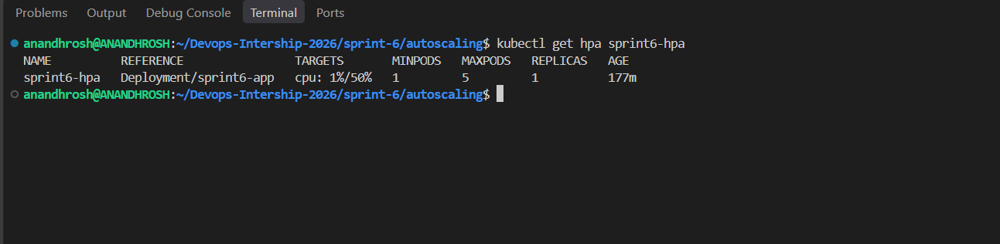
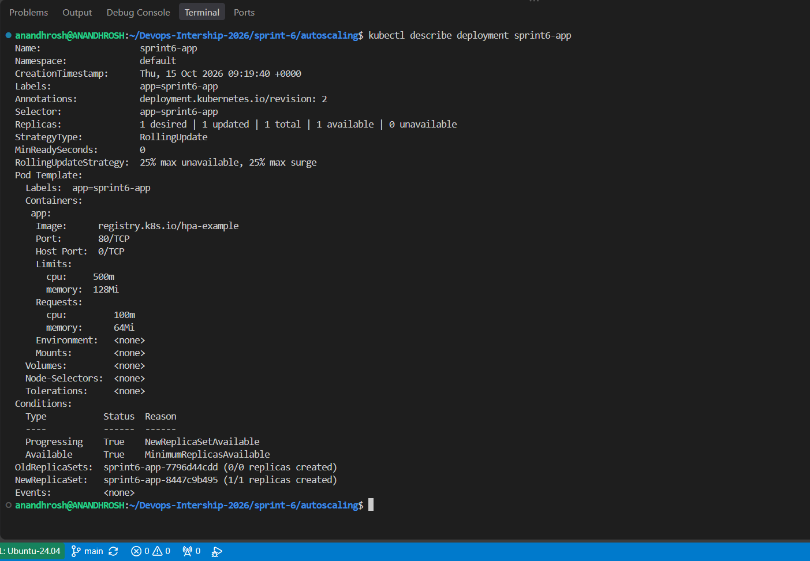
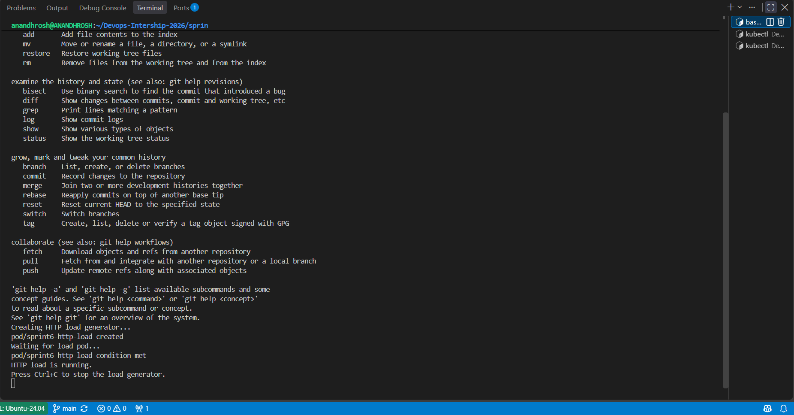
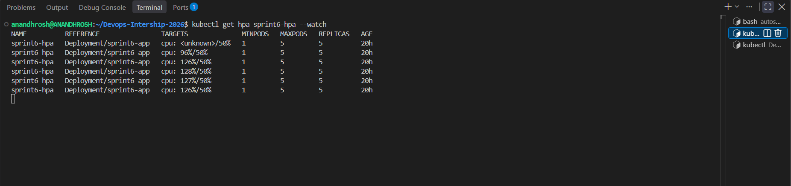
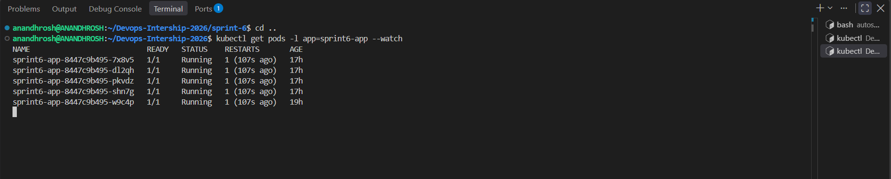
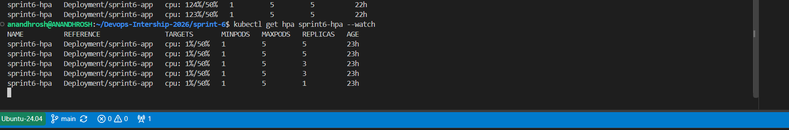
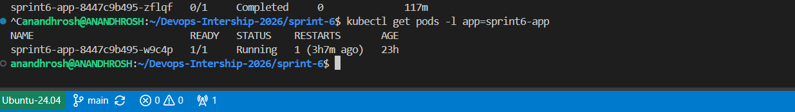

# Sprint 6: Dynamic Workload Scaling & Resource Management on Kubernetes

## Project Title

**Dynamic Workload Scaling & Resource Management on Kubernetes**

## Description

This project demonstrates how to implement automatic application scaling and resource management on Kubernetes using a Deployment, Service, Metrics Server, and Horizontal Pod Autoscaler (HPA).

The project deploys a sample HTTP application using the `registry.k8s.io/hpa-example` container image. Kubernetes resource requests and limits are configured to control CPU and memory allocation for each application pod.

The Metrics Server collects resource utilization data from the Kubernetes cluster. The Horizontal Pod Autoscaler uses this data to automatically adjust the number of application replicas based on CPU utilization.

The HPA is configured with a minimum of one replica, a maximum of five replicas, and a target CPU utilization of 50%.

An HTTP load generator sends repeated requests to the application Service. When CPU utilization increases, Kubernetes scales the Deployment up to handle the load. After the load generator stops, the HPA gradually scales the Deployment back down.

**Note:** HPA scaling is based on observed metrics and Kubernetes scaling behavior. The actual number of replicas and the time required to scale may vary depending on cluster resources and workload.

## Project Objectives

- Enable and verify the Kubernetes Metrics Server.
- Deploy an application using a Kubernetes Deployment.
- Configure CPU and memory requests and limits.
- Expose the application using a ClusterIP Service.
- Configure a Horizontal Pod Autoscaler using `autoscaling/v2`.
- Set the HPA minimum replicas to 1 and maximum replicas to 5.
- Configure the target CPU utilization to 50%.
- Generate HTTP traffic to increase application workload.
- Verify automatic scale-up during high CPU utilization.
- Verify automatic scale-down after the load stops.
- Document the implementation using terminal logs and screenshots.

## Getting Started

### Dependencies

Ensure the following tools are available in your Ubuntu/WSL environment:

- Docker Desktop with WSL integration
- Ubuntu on WSL
- Minikube
- kubectl
- Metrics Server
- Git
- BusyBox container image for generating HTTP requests

### Installing

1. Open the Ubuntu terminal and move to the repository:

   ```bash
   cd ~/Devops-Intership-2026
   ```

2. Start Minikube:

   ```bash
   minikube start
   ```

3. Confirm that the Kubernetes node is ready:

   ```bash
   kubectl get nodes
   ```

   Expected result: the Minikube node should show `Ready`.

4. Check the Minikube status:

   ```bash
   minikube status
   ```

5. Enable the Metrics Server addon:

   ```bash
   minikube addons enable metrics-server
   ```

6. Verify that Metrics Server is running:

   ```bash
   kubectl get deployment metrics-server -n kube-system
   kubectl get pods -n kube-system
   ```

7. Verify that resource metrics are available:

   ```bash
   kubectl top nodes
   ```

   Expected result: CPU and memory utilization should be displayed for the Minikube node. If metrics are not immediately available, wait briefly and run the command again.

## Executing Program

### 1. Create the Sprint 6 directory

From the repository root, create the project directories if they do not already exist:

```bash
mkdir -p sprint-6/autoscaling
mkdir -p sprint-6/Screenshots
cd sprint-6
```

The `autoscaling` directory contains the Kubernetes manifests and the load-testing script.

### 2. Configure the application Deployment

The file `autoscaling/deployment.yaml` defines the application Deployment.

The configuration includes:

- Deployment name: `sprint6-app`
- Container image: `registry.k8s.io/hpa-example`
- Initial replicas: 1
- Container port: 80
- CPU request: `100m`
- CPU limit: `500m`
- Memory request: `64Mi`
- Memory limit: `128Mi`

Apply the Deployment:

```bash
kubectl apply -f autoscaling/deployment.yaml
```

Verify the Deployment:

```bash
kubectl get deployment sprint6-app
kubectl describe deployment sprint6-app
```

The Deployment controller maintains the desired number of application pods and replaces pods when necessary.

### 3. Create the application Service

The file `autoscaling/service.yaml` defines the Service named `sprint6-service`.

The Service uses the `ClusterIP` type and forwards traffic from port 80 to port 80 on the application pods.

Apply the Service:

```bash
kubectl apply -f autoscaling/service.yaml
```

Verify the Service:

```bash
kubectl get service sprint6-service
kubectl describe service sprint6-service
```

The Service provides a stable internal address through which the load generator can access the application.

### 4. Configure resource requests and limits

The Deployment defines the following resource configuration:

| Resource | Request | Limit |
|---|---:|---:|
| CPU | `100m` | `500m` |
| Memory | `64Mi` | `128Mi` |

**CPU request — `100m`:** The container requests 100 millicores of CPU for scheduling and resource calculations.

**CPU limit — `500m`:** The container is limited to 500 millicores of CPU.

**Memory request — `64Mi`:** The container requests 64 MiB of memory.

**Memory limit — `128Mi`:** The container is limited to 128 MiB of memory.

The CPU request is especially important for HPA CPU utilization calculations. The HPA compares measured CPU usage with the requested CPU amount to calculate utilization.

Verify the resource configuration:

```bash
kubectl describe deployment sprint6-app
kubectl get pods -l app=sprint6-app
kubectl top pods
```

### 5. Configure the Horizontal Pod Autoscaler

The file `autoscaling/hpa.yaml` defines the Horizontal Pod Autoscaler named `sprint6-hpa`.

The HPA configuration includes:

- Target Deployment: `sprint6-app`
- Minimum replicas: 1
- Maximum replicas: 5
- Target CPU utilization: 50%
- API version: `autoscaling/v2`

Apply the HPA:

```bash
kubectl apply -f autoscaling/hpa.yaml
```

Verify the HPA:

```bash
kubectl get hpa sprint6-hpa
kubectl describe hpa sprint6-hpa
```

The HPA uses CPU metrics supplied through the Kubernetes resource metrics API. When the observed CPU utilization remains above the target, it can increase the replica count. When demand decreases, it can reduce the replica count, subject to Kubernetes scaling behavior and stabilization settings.

### 6. Verify the application resources

Run the following commands:

```bash
kubectl get deployment sprint6-app
kubectl get service sprint6-service
kubectl get hpa sprint6-hpa
kubectl get pods -l app=sprint6-app
```

Expected result:

- The Deployment is available.
- The Service exists.
- The HPA targets `Deployment/sprint6-app`.
- The minimum and maximum replicas are 1 and 5.
- The initial replica count is normally 1 when there is no significant load.

### 7. Generate HTTP load

The file `autoscaling/load-test.sh` creates a BusyBox pod named `sprint6-http-load`.

The load generator repeatedly sends HTTP requests to:

`http://sprint6-service/`

Make the script executable:

```bash
chmod +x autoscaling/load-test.sh
```

Run the load generator:

```bash
./autoscaling/load-test.sh
```

The script creates the load-generator pod and waits until it becomes ready. It then continues generating HTTP requests until stopped.

Expected output includes messages indicating that the load generator is being created and that HTTP load is running.

**Important:** Keep the load generator running while monitoring the HPA. Stop it with `Ctrl+C` when the scale-up test is complete. The script includes cleanup logic to delete the load-generator pod when it exits normally through the interrupt handler.

### 8. Monitor HPA scale-up

Open another Ubuntu terminal and move to the repository if needed.

Monitor the HPA:

```bash
kubectl get hpa sprint6-hpa --watch
```

In another terminal, monitor the application pods:

```bash
kubectl get pods -l app=sprint6-app --watch
```

Check current resource usage:

```bash
kubectl top pods
```

During the load test, CPU utilization rises above the configured target of 50%. The HPA responds by increasing the number of replicas.

In this project, the Deployment scaled up to five application pods during the load test.

Expected behavior:

- CPU utilization increases above the target.
- The HPA increases the desired replica count.
- Additional application pods are created.
- The replica count can reach the configured maximum of five.

The exact CPU percentages and timing may vary between runs.

### 9. Verify that five replicas are running

Run:

```bash
kubectl get deployment sprint6-app
kubectl get pods -l app=sprint6-app
kubectl get hpa sprint6-hpa
```

During the successful load test, five application pods were running.

This demonstrates that the HPA can scale the application beyond its initial single replica when CPU demand increases.

### 10. Stop the HTTP load generator

Return to the terminal running the load-test script and press:

```text
Ctrl+C
```

The script's cleanup handler attempts to delete the `sprint6-http-load` pod.

Verify that the load-generator pod has been removed:

```bash
kubectl get pod sprint6-http-load
```

The command may report that the pod was not found, which is expected after cleanup.

### 11. Verify HPA scale-down

Continue monitoring the HPA:

```bash
kubectl get hpa sprint6-hpa --watch
```

Monitor the application pods in another terminal:

```bash
kubectl get pods -l app=sprint6-app --watch
```

Check resource utilization:

```bash
kubectl top pods
```

After the load stops, CPU utilization falls. The HPA can then reduce the number of application replicas toward the configured minimum of one.

In this project, the HPA successfully scaled down from five replicas to one replica after the load generator stopped.

Example final HPA state:

```text
NAME          REFERENCE                TARGETS    MINPODS   MAXPODS   REPLICAS
sprint6-hpa   Deployment/sprint6-app   cpu: 1%/50% 1        5         1
```

The final CPU percentage may differ when the commands are run again.

Verify the final Deployment and pods:

```bash
kubectl get deployment sprint6-app
kubectl get pods -l app=sprint6-app
kubectl get hpa sprint6-hpa
```

Expected result: one application pod remains running, and the HPA reports one replica after the scale-down process has completed.

**Result: PASSED.** The application scaled up to five replicas under HTTP load and scaled down to one replica after the load stopped.

### 12. Final verification commands

Run the following commands from the repository root:

```bash
kubectl get nodes
kubectl top nodes
kubectl get deployment sprint6-app
kubectl get service sprint6-service
kubectl get hpa sprint6-hpa
kubectl get pods -l app=sprint6-app
kubectl describe hpa sprint6-hpa
ls -l sprint-6/autoscaling/
ls -lh sprint-6/Screenshots/
```

These commands verify cluster metrics, application resources, HPA configuration, and the project files.

## Technical Explanation

### What is a Deployment?

A Kubernetes Deployment manages replicated application pods.

It maintains the desired number of replicas, replaces failed pods, and supports controlled application updates.

In this project, the Deployment named `sprint6-app` manages the sample HTTP application.

### What is the Metrics Server?

Metrics Server collects resource usage information from Kubernetes nodes and pods and makes it available through the Kubernetes resource metrics API.

The HPA uses these metrics to determine whether application replicas should increase or decrease.

Metrics Server is a metrics collection component; it is not a long-term monitoring or historical metrics database.

### What are CPU requests and limits?

A CPU request specifies the amount of CPU used for Kubernetes scheduling and resource calculations.

A CPU limit restricts the amount of CPU a container can consume.

The HPA's CPU utilization target is calculated relative to the configured CPU request. Therefore, resource requests must be configured correctly for CPU-based autoscaling.

### What is a Horizontal Pod Autoscaler?

A Horizontal Pod Autoscaler automatically adjusts the number of replicas of a supported Kubernetes workload based on observed metrics.

In this project:

- The minimum number of replicas is 1.
- The maximum number of replicas is 5.
- The target average CPU utilization is 50%.

When measured CPU utilization is above the target, the HPA can increase replicas. When utilization falls and remains low enough, the HPA can decrease replicas.

Scaling is not instantaneous. Kubernetes uses periodic metric evaluation and scaling behavior, so replicas may take time to increase or decrease.

### What is a ClusterIP Service?

A ClusterIP Service exposes an application internally within the Kubernetes cluster.

The Service named `sprint6-service` provides a stable internal endpoint for the BusyBox load generator to send HTTP requests to the application pods.

The Service selects application pods using the label `app: sprint6-app`.

### What is a load generator?

A load generator sends repeated requests to an application to simulate traffic.

In this project, a BusyBox pod uses a loop with `wget` to repeatedly request the application Service. This increases workload on the application and helps demonstrate automatic scaling.

### Request and scaling flow

1. Minikube runs the Kubernetes cluster.
2. Metrics Server collects CPU and memory metrics.
3. The Deployment creates the initial application pod.
4. The Service exposes the application internally.
5. The HPA monitors CPU utilization against the 50% target.
6. The BusyBox load generator sends repeated HTTP requests.
7. CPU utilization rises above the target.
8. The HPA increases the number of application replicas, up to five.
9. The load generator is stopped.
10. CPU utilization decreases.
11. The HPA reduces the replica count toward one.
12. The final state is verified using `kubectl` commands.

## Security and Resource Management

- Configure appropriate CPU and memory requests for application containers.
- Set resource limits to help prevent individual containers from consuming excessive resources.
- Use trusted container images and update them when necessary.
- Avoid running unnecessary workloads in the cluster during autoscaling tests.
- Verify metrics availability before relying on CPU-based HPA behavior.
- Use monitoring and logging solutions for production environments.
- Remember that scaling replicas does not automatically guarantee application availability or eliminate application bottlenecks.
- Review resource requests, limits, and scaling targets before using the configuration in production.

## Help

### Metrics Server metrics are unavailable

Check the Metrics Server deployment and pods:

```bash
kubectl get deployment metrics-server -n kube-system
kubectl get pods -n kube-system
kubectl top nodes
kubectl top pods
```

If the addon is not enabled, run:

```bash
minikube addons enable metrics-server
```

Wait for the Metrics Server to become ready before checking metrics again.

### HPA displays unknown CPU utilization

Check the HPA and its events:

```bash
kubectl describe hpa sprint6-hpa
kubectl get hpa sprint6-hpa
kubectl top pods
```

Confirm that Metrics Server is healthy and that the application containers have CPU requests configured.

### Application pod is not starting

Check the Deployment, pod status, events, and logs:

```bash
kubectl get deployment sprint6-app
kubectl get pods -l app=sprint6-app
kubectl describe deployment sprint6-app
kubectl describe pod <pod-name>
kubectl logs <pod-name>
```

Replace `<pod-name>` with the actual application pod name.

### HPA does not scale up

Check the HPA status and current CPU utilization:

```bash
kubectl get hpa sprint6-hpa
kubectl describe hpa sprint6-hpa
kubectl top pods
kubectl get pods -l app=sprint6-app
```

Ensure that the load generator is running and that CPU utilization rises above the target for long enough to trigger scaling.

### HPA does not scale down immediately

HPA scale-down can take time because Kubernetes evaluates metrics periodically and applies scaling behavior.

Check the current replica count and utilization:

```bash
kubectl get hpa sprint6-hpa --watch
kubectl get pods -l app=sprint6-app
kubectl top pods
```

Ensure that the load generator has stopped and allow time for the HPA to scale down.

### Load generator fails

Check whether the load-generator pod exists and inspect its status:

```bash
kubectl get pod sprint6-http-load
kubectl describe pod sprint6-http-load
kubectl logs sprint6-http-load
kubectl get service sprint6-service
```

Confirm that the application pods are running and that the Service has ready endpoints.

## Run the Project

### 1. Go to the Sprint 6 directory

```bash
cd ~/Devops-Intership-2026/sprint-6
```

### 2. Start Minikube

```bash
minikube start
```

### 3. Check Minikube and Kubernetes

```bash
minikube status
kubectl get nodes
```

### 4. Enable and verify Metrics Server

```bash
minikube addons enable metrics-server
kubectl get deployment metrics-server -n kube-system
kubectl top nodes
```

### 5. Deploy the application

```bash
kubectl apply -f autoscaling/deployment.yaml
```

### 6. Create the Service

```bash
kubectl apply -f autoscaling/service.yaml
```

### 7. Configure the HPA

```bash
kubectl apply -f autoscaling/hpa.yaml
```

### 8. Verify the resources

```bash
kubectl get deployment sprint6-app
kubectl get service sprint6-service
kubectl get hpa sprint6-hpa
kubectl get pods -l app=sprint6-app
```

### 9. Generate HTTP load

```bash
chmod +x autoscaling/load-test.sh
./autoscaling/load-test.sh
```

### 10. Monitor scaling

In another terminal:

```bash
kubectl get hpa sprint6-hpa --watch
```

In a separate terminal:

```bash
kubectl get pods -l app=sprint6-app --watch
```

### 11. Stop the load generator and verify scale-down

Press `Ctrl+C` in the load-generator terminal, then run:

```bash
kubectl get hpa sprint6-hpa
kubectl get deployment sprint6-app
kubectl get pods -l app=sprint6-app
```

Wait for the replica count to return to one.

## Proof of Work

The following screenshots document the successful implementation of dynamic workload scaling and resource management.

Save the screenshots in the `Screenshots/` directory using the filenames below. The Markdown image links will display correctly when the files exist at these locations.

### 1. Final HPA Status

This screenshot shows the HPA configuration, CPU target, minimum and maximum replicas, and the final one-replica state.



### 2. Deployment Resource Requests and Limits

This screenshot shows the CPU and memory requests and limits configured for the application.



### 3. HTTP Load Generator

This screenshot shows the BusyBox load-generator pod being created and the HTTP load test running.



### 4. HPA Scale-Up

This screenshot shows CPU utilization rising above the 50% target and the HPA increasing the replica count during the load test.



### 5. Application Pods During Scale-Up

This screenshot shows the application scaling up to five pods during the HTTP load test.



### 6. HPA Scale-Down

This screenshot shows the HPA reducing the replica count after the load generator stops.



### 7. Application Pods After Scale-Down

This screenshot shows the application returning to one running pod after the load test.



## Authors

**Anandhrosh S**

DevOps Internship 2026

GitHub: https://github.com/Anandhrosh

Repository: https://github.com/Anandhrosh/Devops-Intership-2026

## Version History

- **0.1.0** — Initial Sprint 6 implementation with Kubernetes resource requests and limits, Metrics Server, Horizontal Pod Autoscaler, HTTP load testing, and scale-up/scale-down verification.

## License

This project is intended for educational purposes as part of the DevOps Internship 2026.

## Acknowledgments

- Kubernetes documentation
- Minikube documentation
- Kubernetes Metrics Server documentation
- Kubernetes Horizontal Pod Autoscaler documentation