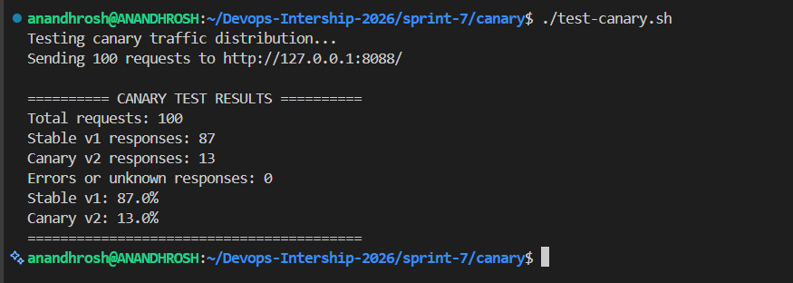
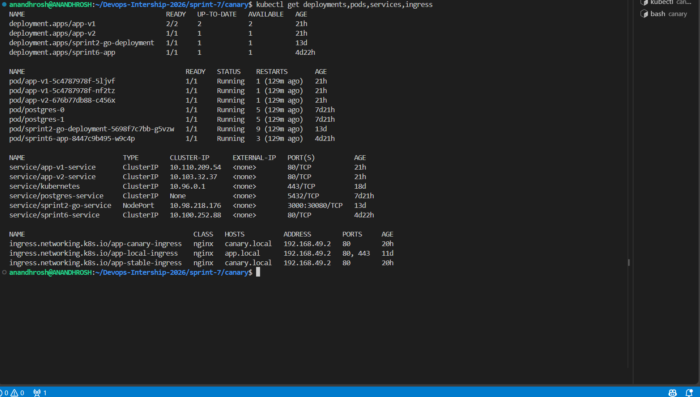
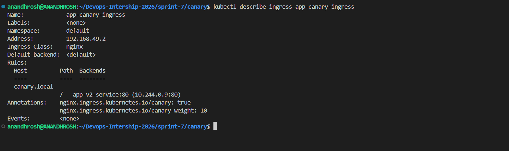
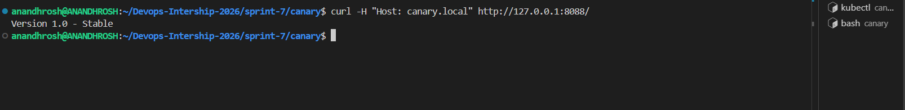

# Sprint 7: Canary Deployments on Kubernetes

## Project Title

**Canary Deployments Using Kubernetes and NGINX Ingress**

## Description

This project demonstrates how to implement canary deployments on Kubernetes using Deployments, Services, and the NGINX Ingress Controller.

The project deploys two versions of a sample HTTP application. Version 1.0 acts as the stable application, while Version 2.0 acts as the canary application. NGINX Ingress distributes traffic between the two versions using a canary weight configuration.

The stable application runs two replicas, and the canary application runs one replica. The stable Ingress routes normal traffic to Version 1.0, while the canary Ingress is configured to direct approximately 10% of eligible traffic to Version 2.0.

A Bash test script sends 100 HTTP requests and counts the responses from both application versions. This helps verify the traffic distribution and identify request errors.

**Note:** Canary traffic distribution is probabilistic. The observed percentage may vary between test runs, even when the configured canary weight remains 10%.

## Project Objectives

- Deploy a stable application version using Kubernetes.
- Deploy a new canary application version alongside the stable version.
- Create separate Services for the stable and canary applications.
- Configure NGINX Ingress to route traffic using the host `canary.local`.
- Configure the canary traffic weight to 10%.
- Verify that the stable and canary applications are running.
- Generate HTTP requests using a Bash test script.
- Measure the observed traffic distribution between both versions.
- Verify that requests complete without errors.
- Document the implementation using terminal screenshots.

## Getting Started

### Dependencies

Ensure the following tools are available in your Ubuntu/WSL environment:

- Docker Desktop with WSL integration
- Ubuntu on WSL
- Minikube
- Kubernetes `kubectl`
- NGINX Ingress Controller
- Git
- `curl`
- Bash

### Installing

1. Open the Ubuntu terminal and move to the repository:

   ```bash
   cd ~/Devops-Intership-2026
   ```

2. Start Minikube:

   ```bash
   minikube start
   ```

3. Confirm that the Kubernetes node is ready:

   ```bash
   kubectl get nodes
   ```

   Expected result: the Minikube node should show `Ready`.

4. Check the Minikube status:

   ```bash
   minikube status
   ```

5. Enable the NGINX Ingress addon if it is not already enabled:

   ```bash
   minikube addons enable ingress
   ```

6. Verify that the Ingress Controller is running:

   ```bash
   kubectl get pods -n ingress-nginx
   ```

7. Verify the Ingress resources:

   ```bash
   kubectl get ingress
   ```

## Executing Program

### 1. Create the Sprint 7 directory

From the repository root, create the project directories if they do not already exist:

```bash
mkdir -p sprint-7/canary
mkdir -p sprint-7/Screenshots
cd sprint-7/canary
```

The `canary` directory contains the Kubernetes manifests and the traffic-testing script.

### 2. Configure the stable Deployment

The file `canary/deployment-v1.yaml` defines the stable application Deployment.

The configuration includes:

- Deployment name: `app-v1`
- Container image: `nginx:alpine`
- Replicas: 2
- Application version: Version 1.0 - Stable
- Container port: 80

The container serves a page identifying it as the stable version.

Apply the Deployment:

```bash
kubectl apply -f deployment-v1.yaml
```

Verify the Deployment:

```bash
kubectl get deployment app-v1
kubectl describe deployment app-v1
kubectl rollout status deployment/app-v1
```

The Deployment controller maintains the desired number of stable application pods.

### 3. Configure the canary Deployment

The file `canary/deployment-v2.yaml` defines the canary application Deployment.

The configuration includes:

- Deployment name: `app-v2`
- Container image: `nginx:alpine`
- Replicas: 1
- Application version: Version 2.0 - Canary
- Container port: 80

Apply the Deployment:

```bash
kubectl apply -f deployment-v2.yaml
```

Verify the Deployment:

```bash
kubectl get deployment app-v2
kubectl describe deployment app-v2
kubectl rollout status deployment/app-v2
```

The canary Deployment runs the new application version separately from the stable version. This allows the new version to be tested before it receives all application traffic.

### 4. Create the application Services

The project uses two Kubernetes Services:

| Service | Purpose |
|---|---|
| `app-v1-service` | Routes traffic to the stable Version 1.0 pods |
| `app-v2-service` | Routes traffic to the canary Version 2.0 pod |

Apply both Services:

```bash
kubectl apply -f service-v1.yaml
kubectl apply -f service-v2.yaml
```

Verify the Services:

```bash
kubectl get services
kubectl describe service app-v1-service
kubectl describe service app-v2-service
```

The Services provide stable internal endpoints for the corresponding application versions.

### 5. Configure the stable Ingress

The file `canary/ingress-stable.yaml` defines the stable Ingress resource named `app-stable-ingress`.

It uses:

- Ingress class: `nginx`
- Host: `canary.local`
- Backend Service: `app-v1-service`
- Backend port: 80

Apply the stable Ingress:

```bash
kubectl apply -f ingress-stable.yaml
```

Verify the configuration:

```bash
kubectl describe ingress app-stable-ingress
```

The stable Ingress defines the normal application route to Version 1.0.

### 6. Configure the canary Ingress

The file `canary/ingress-canary.yaml` defines the canary Ingress resource named `app-canary-ingress`.

It uses the same host and path as the stable Ingress, but routes canary traffic to `app-v2-service`.

The canary configuration includes the following annotations:

```yaml
nginx.ingress.kubernetes.io/canary: "true"
nginx.ingress.kubernetes.io/canary-weight: "10"
```

The first annotation enables canary behavior. The second configures a 10% canary traffic weight.

Apply the canary Ingress:

```bash
kubectl apply -f ingress-canary.yaml
```

Verify the configuration:

```bash
kubectl describe ingress app-canary-ingress
kubectl get ingress
```

NGINX Ingress uses the stable and canary Ingress resources together to distribute requests between the two application versions.

### 7. Access the application

Start port forwarding in a separate terminal:

```bash
kubectl port-forward -n ingress-nginx service/ingress-nginx-controller 8088:80
```

Keep the port-forwarding command running.

Open another terminal and navigate to the canary directory:

```bash
cd ~/Devops-Intership-2026/sprint-7/canary
```

Send an HTTP request with the correct Host header:

```bash
curl -H "Host: canary.local" http://127.0.0.1:8088/
```

A successful response identifies the application version that handled the request.

### 8. Test canary traffic distribution

The file `canary/test-canary.sh` sends 100 HTTP requests through the NGINX Ingress Controller.

The script counts:

- Stable Version 1.0 responses
- Canary Version 2.0 responses
- Errors or unknown responses

Make the script executable:

```bash
chmod +x test-canary.sh
```

Run the test:

```bash
./test-canary.sh
```

**Observed test result:**

| Result | Responses | Percentage |
|---|---:|---:|
| Stable Version 1.0 | 87 | 87% |
| Canary Version 2.0 | 13 | 13% |
| Errors or unknown responses | 0 | 0% |

The test completed 100 requests without errors. The observed canary percentage was 13%, while the configured canary weight remained 10%.

The observed distribution can vary between runs because the traffic split is probabilistic.

### 9. Verify Kubernetes resources

Run the following command:

```bash
kubectl get deployments,pods,services,ingress
```

The verification showed:

- `app-v1` deployment: 2/2 replicas ready.
- `app-v2` deployment: 1/1 replica ready.
- `app-v1-service` and `app-v2-service` present.
- `app-stable-ingress` and `app-canary-ingress` present.
- Both Ingress resources use the host `canary.local`.

These results confirm that the stable and canary application resources are running and configured.

### 10. Canary promotion

After validating Version 2.0, promote it by changing the stable Ingress backend to `app-v2-service` and removing the separate canary Ingress.

**Run these commands only when you intend to promote Version 2.0.**

```bash
kubectl patch ingress app-stable-ingress --type=json -p='[{"op":"replace","path":"/spec/rules/0/http/paths/0/backend/service/name","value":"app-v2-service"}]'
kubectl delete ingress app-canary-ingress
```

Verify the promoted version:

```bash
curl -H "Host: canary.local" http://127.0.0.1:8088/
```

Expected response:

```text
Version 2.0 - Canary
```

After promotion, the stable Ingress routes application traffic to Version 2.0.

### 11. Rollback

If Version 2.0 has problems after promotion, route traffic back to Version 1.0 by updating the stable Ingress backend:

```bash
kubectl patch ingress app-stable-ingress --type=json -p='[{"op":"replace","path":"/spec/rules/0/http/paths/0/backend/service/name","value":"app-v1-service"}]'
```

Verify the rollback:

```bash
curl -H "Host: canary.local" http://127.0.0.1:8088/
```

Expected response:

```text
Version 1.0 - Stable
```

This rollback changes the stable Ingress backend back to the original stable Service.

### 12. Final verification commands

Run the following commands from the repository root:

```bash
kubectl get nodes
kubectl get deployments,pods,services,ingress
kubectl describe ingress app-stable-ingress
kubectl describe ingress app-canary-ingress
ls -l sprint-7/canary/
ls -lh sprint-7/Screenshots/
```

These commands verify the Kubernetes resources, Ingress configuration, and project files.

## Technical Explanation

### What is a Canary Deployment?

A canary deployment is a release strategy in which a new application version receives a limited amount of traffic while the existing version continues serving most requests.

This helps validate the new version before promoting it to handle all traffic.

In this project, Version 1.0 is the stable version, and Version 2.0 is the canary version.

### What is NGINX Ingress?

An Ingress manages HTTP and HTTPS access to applications running inside a Kubernetes cluster.

The NGINX Ingress Controller processes Ingress rules and routes requests to the configured Kubernetes Services.

In this project, the controller routes requests for `canary.local` to the stable and canary application versions.

### What is canary traffic weight?

The canary weight determines the approximate percentage of eligible requests routed to the canary version.

This project uses:

- Stable application: Version 1.0
- Canary application: Version 2.0
- Canary weight: 10%

The observed request distribution may differ slightly from the configured weight because traffic splitting is probabilistic.

### What is a Kubernetes Service?

A Service provides a stable network endpoint for a group of application pods.

The `app-v1-service` selects the stable application pods, while `app-v2-service` selects the canary application pods.

This allows Ingress to route requests to each version without directly targeting individual pod addresses.

### Request flow

1. A client sends an HTTP request to the NGINX Ingress Controller.
2. The request uses the host `canary.local`.
3. The stable Ingress defines the normal route to `app-v1-service`.
4. The canary Ingress applies the configured canary weight.
5. NGINX routes eligible requests to `app-v2-service` according to the canary configuration.
6. The application responds with its version identifier.
7. The test script counts the responses from each version.
8. The results help verify the observed traffic distribution.

## Security and Resource Management

- Use trusted container images and keep them updated.
- Configure appropriate resource requests and limits for production workloads.
- Avoid exposing internal Services unnecessarily.
- Validate the canary version before promotion.
- Monitor application health and error rates during canary testing.
- Keep stable and canary configurations separate for easier troubleshooting.
- Test rollback procedures before using canary deployments in production.

## Help

### Ingress Controller is not running

Check the Ingress Controller pods:

```bash
kubectl get pods -n ingress-nginx
kubectl get services -n ingress-nginx
```

If the Minikube Ingress addon is disabled, enable it:

```bash
minikube addons enable ingress
```

### Application pods are not ready

Check the Deployments and pods:

```bash
kubectl get deployments,pods
kubectl describe deployment app-v1
kubectl describe deployment app-v2
```

Inspect pod logs if necessary:

```bash
kubectl logs deployment/app-v1
kubectl logs deployment/app-v2
```

### Application returns an unexpected response

Check the Services and Ingress resources:

```bash
kubectl get services
kubectl get ingress
kubectl describe ingress app-stable-ingress
kubectl describe ingress app-canary-ingress
```

Confirm that the Host header is set to `canary.local` when testing through port forwarding.

### Canary traffic is not observed

Check the canary annotations and backend:

```bash
kubectl describe ingress app-canary-ingress
kubectl get endpoints app-v1-service
kubectl get endpoints app-v2-service
```

Confirm that the canary annotation is enabled, the weight is configured, and the canary Service has ready endpoints.

A 10% canary weight does not guarantee that every small test batch will contain exactly 10% canary responses.

### Port forwarding is not accessible

Run the port-forwarding command and keep it active:

```bash
kubectl port-forward -n ingress-nginx service/ingress-nginx-controller 8088:80
```

Then test the application from another terminal:

```bash
curl -H "Host: canary.local" http://127.0.0.1:8088/
```

## Run the Project

### 1. Go to the Sprint 7 directory

```bash
cd ~/Devops-Intership-2026/sprint-7/canary
```

### 2. Start Minikube

```bash
minikube start
```

### 3. Enable and verify NGINX Ingress

```bash
minikube addons enable ingress
kubectl get pods -n ingress-nginx
```

### 4. Deploy both application versions

```bash
kubectl apply -f deployment-v1.yaml
kubectl apply -f deployment-v2.yaml
```

### 5. Create the Services

```bash
kubectl apply -f service-v1.yaml
kubectl apply -f service-v2.yaml
```

### 6. Configure the stable and canary Ingress resources

```bash
kubectl apply -f ingress-stable.yaml
kubectl apply -f ingress-canary.yaml
```

### 7. Verify the application resources

```bash
kubectl get deployments,pods,services,ingress
```

### 8. Start port forwarding

In a separate terminal:

```bash
kubectl port-forward -n ingress-nginx service/ingress-nginx-controller 8088:80
```

### 9. Test the application

In the application terminal:

```bash
curl -H "Host: canary.local" http://127.0.0.1:8088/
```

### 10. Run the canary traffic test

```bash
chmod +x test-canary.sh
./test-canary.sh
```

### 11. Review the test results

The script reports the total requests, stable responses, canary responses, and errors. Compare the observed distribution with the configured 10% canary weight.

## Proof of Work

The following screenshots document the successful implementation of canary deployments.

Save the screenshots in the `Screenshots/` directory using the filenames below.

### 1. Canary Traffic Test Results

This screenshot shows the 100-request test, the stable and canary response counts, and the absence of errors.



### 2. Kubernetes Resources

This screenshot shows the application Deployments, pods, Services, and Ingress resources.



### 3. Canary Ingress Configuration

This screenshot shows the canary annotation, the 10% weight, and the canary backend Service.



### 4. Application Response

This screenshot shows a successful response from the application through NGINX Ingress.



## Authors

**Anandhrosh S**

DevOps Internship 2026

GitHub: https://github.com/Anandhrosh

Repository: https://github.com/Anandhrosh/Devops-Intership-2026

## Version History

- **0.1.0** — Initial Sprint 7 implementation with stable and canary Deployments, Kubernetes Services, NGINX Ingress traffic splitting, and HTTP traffic testing.

## License

This project is intended for educational purposes as part of the DevOps Internship 2026.

## Acknowledgments

- Kubernetes documentation
- Minikube documentation
- NGINX Ingress Controller documentation
- Kubernetes Ingress documentation