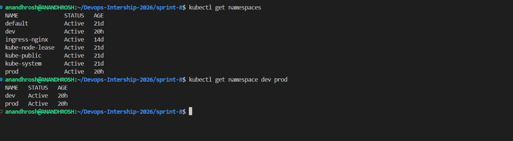
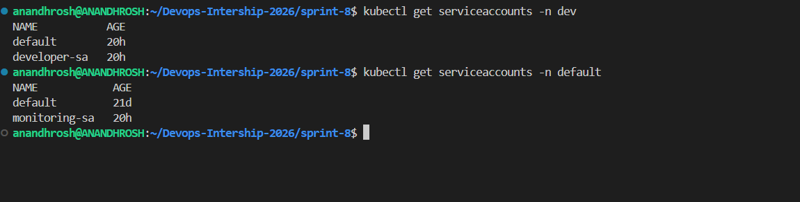
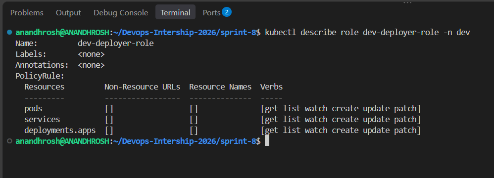
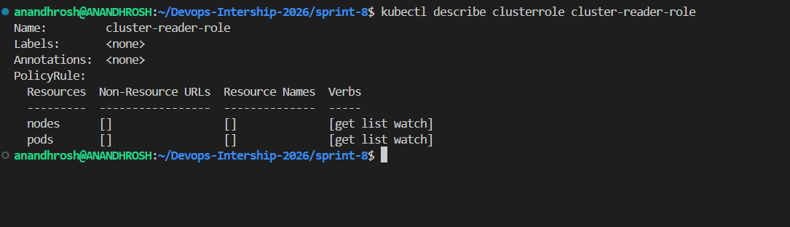
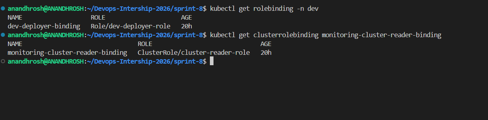
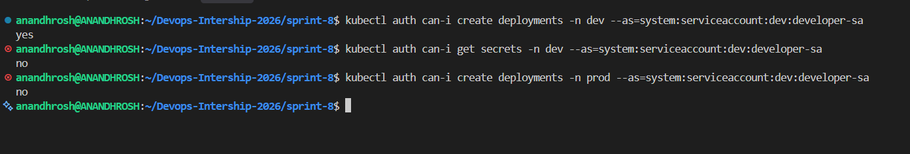
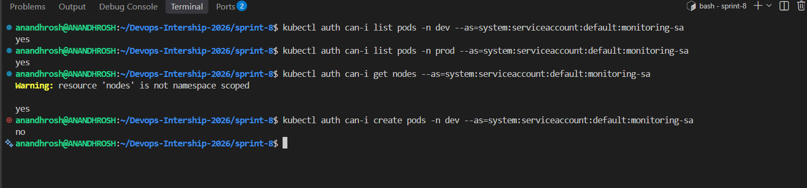

# Sprint 8: Kubernetes Security & RBAC

## Project Title

**Kubernetes Security & Role-Based Access Control (RBAC)**

## Description

This project demonstrates Kubernetes Role-Based Access Control (RBAC) using Namespaces, ServiceAccounts, Roles, ClusterRoles, RoleBindings, and ClusterRoleBindings.

The project creates separate `dev` and `prod` namespaces and configures two ServiceAccounts for different purposes. The developer ServiceAccount receives limited permissions to manage selected application resources in the `dev` namespace. The monitoring ServiceAccount receives read-only access to Pods and Nodes across the cluster.

Kubernetes RBAC permissions are assigned according to the principle of least privilege. This means that each ServiceAccount receives only the permissions granted by its associated RBAC configuration.

The project uses `kubectl auth can-i` commands to verify the permissions and demonstrate that unauthorized actions are denied.

## Project Objectives

- Create `dev` and `prod` namespaces.
- Create dedicated developer and monitoring ServiceAccounts.
- Configure a namespace-scoped Role for the developer.
- Allow developers to manage Pods, Services, and Deployments in `dev`.
- Prevent the developer Role from granting access to Secrets or resource deletion.
- Prevent the developer ServiceAccount from managing resources in `prod`.
- Create a read-only ClusterRole for monitoring Pods and Nodes.
- Configure RoleBinding and ClusterRoleBinding resources.
- Verify allowed and denied actions using `kubectl auth can-i`.
- Document the implementation using terminal screenshots.

## Getting Started

### Dependencies

Ensure the following tools are available in your Ubuntu/WSL environment:

- Docker Desktop with WSL integration
- Ubuntu on WSL
- Minikube
- Kubernetes `kubectl`
- Git
- Bash

### Installing

1. Open the Ubuntu terminal and move to the repository:

   ```bash
   cd ~/Devops-Intership-2026
   ```

2. Start Minikube:

   ```bash
   minikube start
   ```

3. Confirm that the Kubernetes node is ready:

   ```bash
   kubectl get nodes
   ```

   Expected result: the Minikube node should show `Ready`.

4. Check the Minikube status:

   ```bash
   minikube status
   ```

5. Move to the Sprint 8 project directory:

   ```bash
   cd ~/Devops-Intership-2026/sprint-8
   ```

6. Verify that the RBAC manifests exist:

   ```bash
   ls -l rbac/
   ```

## Executing Program

### 1. Create the Sprint 8 directory structure

From the repository root, create the project directories if they do not already exist:

```bash
mkdir -p sprint-8/rbac
mkdir -p sprint-8/Screenshots
cd sprint-8
```

The `rbac` directory contains the Kubernetes YAML manifests. The `Screenshots` directory contains the evidence collected during verification.

### 2. Configure the namespaces

The file `rbac/namespaces.yaml` defines the following namespaces:

- `dev` — developer application resources.
- `prod` — production application resources.

Apply the namespace configuration:

```bash
kubectl apply -f rbac/namespaces.yaml
```

Verify the namespaces:

```bash
kubectl get namespaces
kubectl get namespace dev prod
```

Both namespaces should show the status `Active`.

### 3. Configure the ServiceAccounts

The file `rbac/serviceaccounts.yaml` defines two ServiceAccounts:

| ServiceAccount | Namespace | Purpose |
|---|---|---|
| `developer-sa` | `dev` | Developer access to selected application resources |
| `monitoring-sa` | `default` | Read-only cluster monitoring |

Apply the ServiceAccount configuration:

```bash
kubectl apply -f rbac/serviceaccounts.yaml
```

Verify the ServiceAccounts:

```bash
kubectl get serviceaccounts -n dev
kubectl get serviceaccounts -n default
```

The output should include `developer-sa` in `dev` and `monitoring-sa` in `default`.

### 4. Configure the developer Role

The file `rbac/dev-deployer-role.yaml` defines a namespace-scoped Role named `dev-deployer-role`.

The Role applies only within the `dev` namespace.

It grants the following verbs:

- `get`
- `list`
- `watch`
- `create`
- `update`
- `patch`

These permissions apply to:

- Pods
- Services
- Deployments

The Role does not grant permission to read Secrets or delete resources.

Apply the Role:

```bash
kubectl apply -f rbac/dev-deployer-role.yaml
```

Verify the configuration:

```bash
kubectl describe role dev-deployer-role -n dev
```

The output should show the permitted resources and verbs.

### 5. Configure the monitoring ClusterRole

The file `rbac/cluster-reader-role.yaml` defines a ClusterRole named `cluster-reader-role`.

Unlike a Role, a ClusterRole can define permissions for cluster-scoped resources and can be bound to grant access across namespaces.

This ClusterRole grants the following read-only verbs:

- `get`
- `list`
- `watch`

The permitted resources are:

- Pods
- Nodes

It does not grant create, update, patch, or delete permissions.

Apply the ClusterRole:

```bash
kubectl apply -f rbac/cluster-reader-role.yaml
```

Verify the configuration:

```bash
kubectl describe clusterrole cluster-reader-role
```

The output should show read-only permissions for Pods and Nodes.

### 6. Configure the RoleBinding

The file `rbac/dev-rolebinding.yaml` defines the RoleBinding `dev-deployer-binding`.

It binds `developer-sa` to `dev-deployer-role` in the `dev` namespace.

Apply the RoleBinding:

```bash
kubectl apply -f rbac/dev-rolebinding.yaml
```

Verify the binding:

```bash
kubectl get rolebinding -n dev
kubectl describe rolebinding dev-deployer-binding -n dev
```

The binding connects the developer ServiceAccount to the namespace-scoped Role.

### 7. Configure the ClusterRoleBinding

The file `rbac/monitoring-clusterrolebinding.yaml` defines the ClusterRoleBinding `monitoring-cluster-reader-binding`.

It binds `monitoring-sa`, located in the `default` namespace, to `cluster-reader-role`.

Apply the ClusterRoleBinding:

```bash
kubectl apply -f rbac/monitoring-clusterrolebinding.yaml
```

Verify the binding:

```bash
kubectl get clusterrolebinding monitoring-cluster-reader-binding
kubectl describe clusterrolebinding monitoring-cluster-reader-binding
```

This binding makes the ClusterRole's permitted read-only access available across namespaces and for Nodes.

### 8. Verify Kubernetes resources

Run the following commands:

```bash
kubectl get namespaces
kubectl get serviceaccounts -n dev
kubectl get serviceaccounts -n default
kubectl get role -n dev
kubectl get clusterrole cluster-reader-role
kubectl get rolebinding -n dev
kubectl get clusterrolebinding monitoring-cluster-reader-binding
```

These commands verify that the namespaces, ServiceAccounts, Roles, and bindings exist.

### 9. Test developer permissions

Use `kubectl auth can-i` to check whether the developer ServiceAccount is authorized to perform specific actions.

Check whether the developer can create Deployments in `dev`:

```bash
kubectl auth can-i create deployments -n dev --as=system:serviceaccount:dev:developer-sa
```

Expected result:

```text
yes
```

Check whether the developer can read Secrets in `dev`:

```bash
kubectl auth can-i get secrets -n dev --as=system:serviceaccount:dev:developer-sa
```

Expected result:

```text
no
```

Check whether the developer can create Deployments in `prod`:

```bash
kubectl auth can-i create deployments -n prod --as=system:serviceaccount:dev:developer-sa
```

Expected result:

```text
no
```

These tests confirm the intended permissions of the developer Role under the configured RBAC setup.

### 10. Test monitoring permissions

Check whether monitoring can list Pods in `dev`:

```bash
kubectl auth can-i list pods -n dev --as=system:serviceaccount:default:monitoring-sa
```

Expected result:

```text
yes
```

Check whether monitoring can list Pods in `prod`:

```bash
kubectl auth can-i list pods -n prod --as=system:serviceaccount:default:monitoring-sa
```

Expected result:

```text
yes
```

Check whether monitoring can read Nodes:

```bash
kubectl auth can-i get nodes --as=system:serviceaccount:default:monitoring-sa
```

Expected result:

```text
yes
```

Check whether monitoring can create Pods in `dev`:

```bash
kubectl auth can-i create pods -n dev --as=system:serviceaccount:default:monitoring-sa
```

Expected result:

```text
no
```

These tests demonstrate that monitoring can read the configured resources but cannot create Pods through the permissions granted by this project.

### 11. Verify additional restrictions

The developer Role does not grant permission to delete Deployments or Namespaces.

Check Deployment deletion:

```bash
kubectl auth can-i delete deployments -n dev --as=system:serviceaccount:dev:developer-sa
```

Expected result:

```text
no
```

Check Namespace deletion:

```bash
kubectl auth can-i delete namespaces --as=system:serviceaccount:dev:developer-sa
```

Expected result:

```text
no
```

These checks demonstrate that the configured developer Role does not grant these destructive permissions.

### 12. Permission matrix

| Action | Developer | Monitoring |
|---|---|---|
| Create Deployments in `dev` | Allowed | Denied |
| Read Secrets in `dev` | Not granted | Not granted |
| Create Deployments in `prod` | Denied | Denied |
| List Pods in `dev` | Allowed | Allowed |
| List Pods in `prod` | Not granted | Allowed |
| Read Nodes | Not granted | Allowed |
| Create Pods in `dev` | Allowed | Denied |
| Delete Deployments in `dev` | Denied | Denied |
| Delete Namespaces | Denied | Denied |

**Note:** These results describe the permissions provided by this project's RBAC configuration. Kubernetes RBAC permissions are additive; another RoleBinding or ClusterRoleBinding could grant additional permissions.

### 13. Final verification commands

Run the following commands from the Sprint 8 directory:

```bash
kubectl get namespaces
kubectl get serviceaccounts -n dev
kubectl get serviceaccounts -n default
kubectl describe role dev-deployer-role -n dev
kubectl describe clusterrole cluster-reader-role
kubectl get rolebinding -n dev
kubectl get clusterrolebinding monitoring-cluster-reader-binding
ls -l rbac/
ls -lh Screenshots/
```

These commands verify the RBAC resources and project files.

## Technical Explanation

### What is Kubernetes RBAC?

Role-Based Access Control (RBAC) is a Kubernetes authorization mechanism that controls which actions users and ServiceAccounts can perform on cluster resources.

RBAC uses Roles, ClusterRoles, RoleBindings, and ClusterRoleBindings to define and associate permissions.

### What is a Namespace?

A Namespace logically separates resources within a Kubernetes cluster.

In this project:

- `dev` is used for developer resources.
- `prod` represents the production environment.

A RoleBinding in `dev` does not automatically grant the same Role permissions in `prod`.

### What is a ServiceAccount?

A ServiceAccount provides an identity for processes or workloads that interact with the Kubernetes API.

In this project, `developer-sa` represents the developer identity, while `monitoring-sa` represents the monitoring identity.

### What is a Role?

A Role defines permissions within a particular namespace.

The `dev-deployer-role` Role permits selected operations on Pods, Services, and Deployments in `dev`.

### What is a ClusterRole?

A ClusterRole defines permissions that can include cluster-scoped resources and resources across namespaces when appropriately bound.

The `cluster-reader-role` ClusterRole permits read-only operations on Pods and Nodes.

### What is a RoleBinding?

A RoleBinding associates a subject, such as a ServiceAccount, with a Role in a specific namespace.

The `dev-deployer-binding` RoleBinding connects `developer-sa` to `dev-deployer-role`.

### What is a ClusterRoleBinding?

A ClusterRoleBinding associates subjects with a ClusterRole across the cluster.

The `monitoring-cluster-reader-binding` ClusterRoleBinding connects `monitoring-sa` to `cluster-reader-role`.

### What is the principle of least privilege?

The principle of least privilege means granting only the access required for a particular responsibility.

This project applies that principle by limiting developer permissions to selected resources in `dev` and providing monitoring with read-only access to Pods and Nodes.

### What does `kubectl auth can-i` do?

The `kubectl auth can-i` command checks whether an identity is authorized to perform a particular action.

The `--as` option specifies the identity being checked. These tests simulate authorization checks for the configured ServiceAccounts; they do not create actual application resources.

## Security and Resource Management

- Grant only the permissions required for each role.
- Avoid granting unnecessary access to Secrets.
- Keep development and production permissions separate.
- Use read-only permissions for monitoring where possible.
- Avoid unnecessary create, update, patch, and delete permissions.
- Review RoleBindings and ClusterRoleBindings regularly.
- Protect ServiceAccount credentials and avoid exposing tokens.
- Remember that additional RBAC bindings may grant permissions beyond those configured in this project.

## Help

### Minikube is not running

Check the cluster:

```bash
minikube status
kubectl get nodes
```

Start Minikube if necessary:

```bash
minikube start
```

### A namespace is missing

Check the existing namespaces:

```bash
kubectl get namespaces
```

Reapply the namespace manifest:

```bash
kubectl apply -f rbac/namespaces.yaml
```

### A ServiceAccount is missing

Check the ServiceAccounts:

```bash
kubectl get serviceaccounts -n dev
kubectl get serviceaccounts -n default
```

Reapply the configuration:

```bash
kubectl apply -f rbac/serviceaccounts.yaml
```

### A permission test returns an unexpected result

Inspect the Roles and bindings:

```bash
kubectl describe role dev-deployer-role -n dev
kubectl describe clusterrole cluster-reader-role
kubectl describe rolebinding dev-deployer-binding -n dev
kubectl describe clusterrolebinding monitoring-cluster-reader-binding
```

Repeat the relevant authorization check:

```bash
kubectl auth can-i create deployments -n dev --as=system:serviceaccount:dev:developer-sa
```

Check whether any other bindings grant additional permissions, because Kubernetes RBAC permissions are additive.

### A manifest fails to apply

Check the manifest files:

```bash
ls -l rbac/
```

Apply the affected manifest again and inspect the error message:

```bash
kubectl apply -f rbac/dev-deployer-role.yaml
```

Replace the filename with the manifest you need to troubleshoot.

## Run the Project

### 1. Go to the Sprint 8 directory

```bash
cd ~/Devops-Intership-2026/sprint-8
```

### 2. Start Minikube

```bash
minikube start
```

### 3. Verify the cluster

```bash
kubectl get nodes
```

### 4. Create the namespaces

```bash
kubectl apply -f rbac/namespaces.yaml
```

### 5. Create the ServiceAccounts

```bash
kubectl apply -f rbac/serviceaccounts.yaml
```

### 6. Apply the developer Role

```bash
kubectl apply -f rbac/dev-deployer-role.yaml
```

### 7. Apply the monitoring ClusterRole

```bash
kubectl apply -f rbac/cluster-reader-role.yaml
```

### 8. Apply the RoleBinding

```bash
kubectl apply -f rbac/dev-rolebinding.yaml
```

### 9. Apply the ClusterRoleBinding

```bash
kubectl apply -f rbac/monitoring-clusterrolebinding.yaml
```

### 10. Verify the permissions

Run the developer and monitoring `kubectl auth can-i` tests described above.

## Proof of Work

The following screenshots document the successful implementation of Kubernetes RBAC.

Save the screenshots in the `Screenshots/` directory using the filenames below.

### 1. Namespace Configuration

This screenshot shows the `dev` and `prod` namespaces in the Active state.



### 2. ServiceAccount Configuration

This screenshot shows `developer-sa` in `dev` and `monitoring-sa` in `default`.



### 3. Developer Role Permissions

This screenshot shows the resources and verbs permitted by `dev-deployer-role`.



### 4. Monitoring ClusterRole Permissions

This screenshot shows the read-only permissions for Pods and Nodes.



### 5. RBAC Bindings

This screenshot shows the developer RoleBinding and monitoring ClusterRoleBinding.



### 6. Developer Permission Tests

This screenshot shows that the developer can create Deployments in `dev`, cannot read Secrets in `dev`, and cannot create Deployments in `prod`.



### 7. Monitoring Read-Only Tests

This screenshot shows that monitoring can list Pods in `dev` and `prod` and read Nodes, but cannot create Pods in `dev`.



## Authors

**Anandhrosh S**

DevOps Internship 2026

GitHub: https://github.com/Anandhrosh

Repository: https://github.com/Anandhrosh/Devops-Intership-2026

## Version History

- **0.1.0** — Initial Sprint 8 implementation with namespaces, ServiceAccounts, namespace-scoped developer permissions, cluster-wide read-only monitoring permissions, and RBAC verification tests.

## License

This project is intended for educational purposes as part of the DevOps Internship 2026.

## Acknowledgments

- Kubernetes documentation
- Minikube documentation
- Kubernetes RBAC documentation
- Kubernetes authorization documentation
