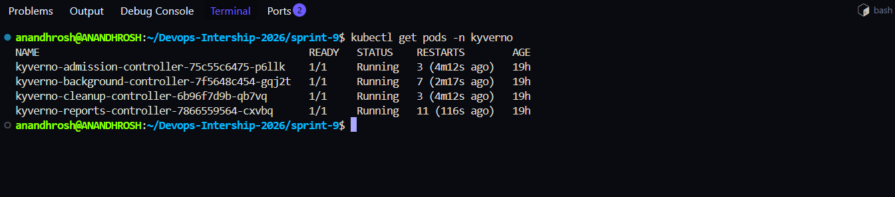
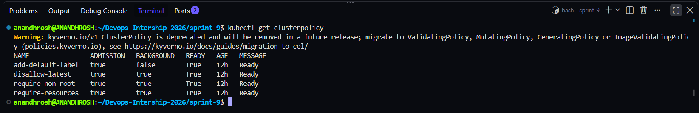
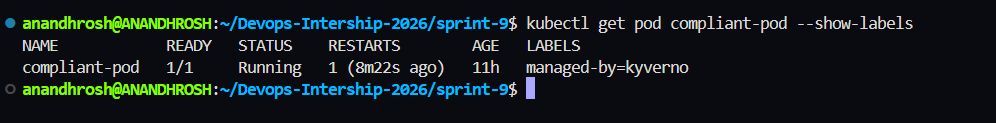
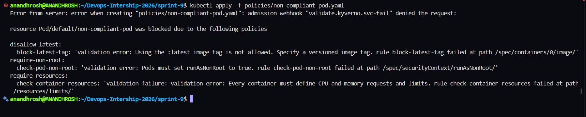
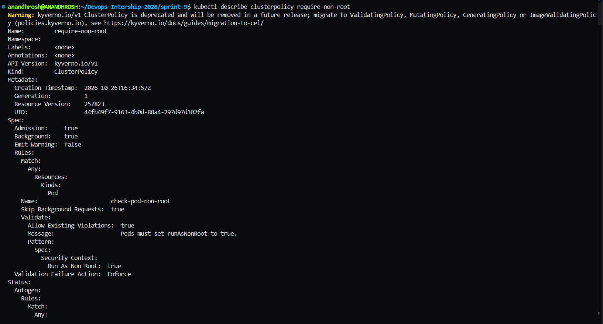

# Sprint 9: Admission Control & Policy-as-Code Governance

## Project Title

**Kubernetes Admission Control & Policy-as-Code Governance using Kyverno**

## Description

This project demonstrates Kubernetes admission control and Policy-as-Code governance using Kyverno. Kyverno validates Kubernetes resources before they are admitted into the cluster and can automatically modify resources to enforce governance requirements.

The project implements three validation policies and one mutation policy. The validation policies enforce non-root execution, require CPU and memory requests and limits, and block container images using the `:latest` tag. The mutation policy automatically adds the `managed-by: kyverno` label to Pods when the label is missing.

The project uses a compliant Pod to demonstrate successful admission and a non-compliant Pod to demonstrate policy enforcement. Terminal screenshots document the installation, policy readiness, compliant resource, rejected resource, and non-root policy configuration.

## Project Objectives

- Install Kyverno in the Kubernetes cluster using Helm.
- Create validation policies using `ClusterPolicy`.
- Enforce `runAsNonRoot: true` for Pods.
- Require CPU and memory requests and limits for every container.
- Block container images using the `:latest` tag.
- Automatically add the `managed-by: kyverno` label to Pods.
- Deploy and verify a compliant Pod.
- Test and demonstrate the rejection of a non-compliant Pod.
- Verify that all four policies are ready.
- Document the implementation using terminal screenshots.

## Getting Started

### Dependencies

Ensure the following tools are available in your Ubuntu/WSL environment:

- Docker Desktop with WSL integration
- Ubuntu on WSL
- Minikube
- Kubernetes `kubectl`
- Helm
- Git
- Bash

### Installing

1. Open the Ubuntu terminal and move to the repository:

   ```bash
   cd ~/Devops-Intership-2026
   ```

2. Start Minikube:

   ```bash
   minikube start
   ```

3. Confirm that the Kubernetes node is ready:

   ```bash
   kubectl get nodes
   ```

   Expected result: the Minikube node should show `Ready`.

4. Check the Minikube status:

   ```bash
   minikube status
   ```

5. Move to the Sprint 9 project directory:

   ```bash
   cd ~/Devops-Intership-2026/sprint-9
   ```

6. Verify the policy manifests:

   ```bash
   ls -l policies/
   ```

7. Verify that Kyverno is installed:

   ```bash
   kubectl get pods -n kyverno
   ```

   Expected result: the Kyverno controller Pods should show `Running`.

## Executing Program

### 1. Create the Sprint 9 directory structure

From the repository root, create the project directories if they do not already exist:

```bash
mkdir -p sprint-9/policies
mkdir -p sprint-9/Screenshots
cd sprint-9
```

The `policies` directory contains the Kubernetes YAML manifests and the NGINX configuration. The `Screenshots` directory contains the evidence collected during verification.

### 2. Install Kyverno

Add the Kyverno Helm repository:

```bash
helm repo add kyverno https://kyverno.github.io/kyverno/
```

Update the Helm repository:

```bash
helm repo update
```

Install Kyverno:

```bash
helm install kyverno kyverno/kyverno \
  --namespace kyverno \
  --create-namespace \
  --wait \
  --timeout 5m
```

Verify the installation:

```bash
kubectl get pods -n kyverno
helm list -n kyverno
```

The Kyverno admission controller evaluates resource requests during admission. Other Kyverno controllers support background policy processing, reporting, and cleanup functions.

**Note:** If Kyverno is already installed, do not run `helm install` again for the existing release. Verify the current installation instead.

### 3. Configure the non-root policy

The file `policies/require-non-root.yaml` defines the `require-non-root` ClusterPolicy.

The policy requires Pods to specify:

```yaml
securityContext:
  runAsNonRoot: true
```

This helps prevent containers from running as the root user. The policy uses `validationFailureAction: Enforce` to reject non-compliant Pod admission requests.

Apply the policy:

```bash
kubectl apply -f policies/require-non-root.yaml
```

Verify the configuration:

```bash
kubectl describe clusterpolicy require-non-root
```

### 4. Configure the resource requirements policy

The file `policies/require-resources.yaml` defines the `require-resources` ClusterPolicy.

It requires every container to define:

- CPU requests
- Memory requests
- CPU limits
- Memory limits

Resource requests help Kubernetes schedule workloads, while resource limits constrain resource consumption.

Apply the policy:

```bash
kubectl apply -f policies/require-resources.yaml
```

Verify the policy:

```bash
kubectl describe clusterpolicy require-resources
```

### 5. Configure the image tag policy

The file `policies/disallow-latest.yaml` defines the `disallow-latest` ClusterPolicy.

It prevents Pods from using container images with the `:latest` tag. Using explicit image versions makes deployments more predictable.

Apply the policy:

```bash
kubectl apply -f policies/disallow-latest.yaml
```

Verify the policy:

```bash
kubectl describe clusterpolicy disallow-latest
```

### 6. Configure the default label mutation policy

The file `policies/add-default-label.yaml` defines the `add-default-label` ClusterPolicy.

This mutation policy adds the following label when it is missing:

```yaml
managed-by: kyverno
```

The label helps identify resources managed through the project's Kyverno policy configuration.

Apply the policy:

```bash
kubectl apply -f policies/add-default-label.yaml
```

Verify the policy:

```bash
kubectl describe clusterpolicy add-default-label
```

### 7. Verify all ClusterPolicies

Run the following command:

```bash
kubectl get clusterpolicy
```

The expected policies are:

| Policy | Purpose |
|---|---|
| `require-non-root` | Enforce non-root execution |
| `require-resources` | Require CPU and memory requests and limits |
| `disallow-latest` | Block the `:latest` image tag |
| `add-default-label` | Add the default management label |

Expected result: all four policies should report `READY True`.

### 8. Deploy the compliant Pod

The file `policies/compliant-pod.yaml` defines a Pod that satisfies the validation policies.

The manifest uses a versioned NGINX image, configures non-root execution, and specifies CPU and memory requests and limits. It also uses the NGINX configuration from `policies/nginx.conf`.

Apply the manifest:

```bash
kubectl apply -f policies/compliant-pod.yaml
```

Check the Pod status:

```bash
kubectl get pod compliant-pod
```

Check its labels:

```bash
kubectl get pod compliant-pod --show-labels
```

Expected result: the Pod should reach `Running` status and include the label `managed-by=kyverno`.

### 9. Test the non-compliant Pod

The file `policies/non-compliant-pod.yaml` intentionally violates the validation policies.

The manifest uses the `nginx:latest` image, does not set `runAsNonRoot: true`, and does not define the required CPU and memory requests and limits.

Attempt to create the Pod:

```bash
kubectl apply -f policies/non-compliant-pod.yaml
```

Expected result: the Kyverno admission webhook rejects the request and reports violations from the three validation policies.

Verify that the Pod was not created:

```bash
kubectl get pod non-compliant-pod
```

Expected result: the Pod should not be found.

This demonstrates that the enforcement policies block a non-compliant resource before it is admitted into the cluster.

### 10. Final verification commands

Run the following commands from the Sprint 9 directory:

```bash
kubectl get pods -n kyverno
kubectl get clusterpolicy
kubectl get pod compliant-pod --show-labels
kubectl describe clusterpolicy require-non-root
ls -l policies/
ls -lh Screenshots/
```

These commands verify the Kyverno installation, policy readiness, compliant Pod, non-root policy configuration, and project files.

## Technical Explanation

### What is Kubernetes Admission Control?

Admission control is part of the Kubernetes API request processing workflow. After authentication and authorization, admission controllers can validate or modify requests before the API server persists the resources.

In this project, Kyverno validates Pod configurations and rejects requests that violate enforced policies.

### What is Kyverno?

Kyverno is a policy engine designed for Kubernetes. It allows administrators to define policies using Kubernetes-style YAML manifests.

Kyverno supports validation, mutation, generation, and other policy capabilities.

### What is Policy-as-Code?

Policy-as-Code means defining governance and security requirements in version-controlled files instead of relying only on manual checks.

In this project, YAML policy manifests define the rules that Kubernetes resources must satisfy.

### What is a ClusterPolicy?

A `ClusterPolicy` defines policy rules that can apply across namespaces in a Kubernetes cluster.

The project uses ClusterPolicies to enforce non-root execution, resource requirements, image tag restrictions, and automatic labelling.

### What is `validationFailureAction: Enforce`?

`validationFailureAction: Enforce` tells Kyverno to reject resources that fail the applicable validation rules.

This prevents non-compliant Pods from being admitted when the policy applies.

### What is non-root execution?

Non-root execution means running a container process as a non-root user rather than as user ID 0.

The `runAsNonRoot: true` setting instructs Kubernetes to ensure that the container does not run as root.

### What are resource requests and limits?

- **Requests:** The CPU and memory amounts Kubernetes uses when scheduling a container.
- **Limits:** The maximum CPU and memory amounts configured for a container.

Requiring these values helps improve workload resource management.

### Why avoid the `:latest` image tag?

The `:latest` tag does not identify a fixed application version. The image associated with it can change over time.

Using an explicit versioned tag makes the intended image version clearer and deployments more predictable.

### What is a mutation policy?

A mutation policy modifies a resource during admission. In this project, the mutation policy adds `managed-by: kyverno` when the label is absent.

### What is a compliant Pod?

A compliant Pod satisfies all applicable enforced validation rules. The project's `compliant-pod` demonstrates successful admission and automatic labelling.

### What is a non-compliant Pod?

A non-compliant Pod violates one or more applicable policy rules. The project's `non-compliant-pod` demonstrates how Kyverno rejects an invalid request.

## Security and Resource Management

- Enforce non-root execution for applicable workloads.
- Require CPU and memory requests and limits.
- Avoid the `:latest` image tag.
- Use policy-as-code to keep governance requirements consistent.
- Automatically apply management labels where required.
- Test policy behavior with both compliant and non-compliant resources.
- Review policy readiness and violations regularly.

## Help

### Minikube is not running

Check the cluster:

```bash
minikube status
kubectl get nodes
```

Start Minikube if necessary:

```bash
minikube start
```

### Kyverno Pods are not running

Check the Kyverno namespace:

```bash
kubectl get pods -n kyverno
kubectl get events -n kyverno --sort-by=.metadata.creationTimestamp
```

Inspect a controller if needed:

```bash
kubectl describe pods -n kyverno
```

### A policy is not ready

Check policy status:

```bash
kubectl get clusterpolicy
kubectl describe clusterpolicy require-non-root
```

Replace the policy name with the policy you need to troubleshoot.

### A compliant Pod fails to start

Inspect the Pod and its events:

```bash
kubectl describe pod compliant-pod
kubectl logs compliant-pod
```

Check the configuration and resource requirements in `policies/compliant-pod.yaml`.

### A non-compliant Pod is rejected

A rejection is expected when a Pod violates an enforced policy.

Inspect the admission error returned by:

```bash
kubectl apply -f policies/non-compliant-pod.yaml
```

Review the validation messages to identify which policies rejected the resource.

### A manifest fails to apply

Check the policy files:

```bash
ls -l policies/
```

Validate the YAML structure and reapply the affected manifest.

## Run the Project

### 1. Go to the Sprint 9 directory

```bash
cd ~/Devops-Intership-2026/sprint-9
```

### 2. Start Minikube

```bash
minikube start
```

### 3. Verify the cluster

```bash
kubectl get nodes
```

### 4. Verify Kyverno

```bash
kubectl get pods -n kyverno
```

### 5. Apply the validation policies

```bash
kubectl apply -f policies/require-non-root.yaml
kubectl apply -f policies/require-resources.yaml
kubectl apply -f policies/disallow-latest.yaml
```

### 6. Apply the mutation policy

```bash
kubectl apply -f policies/add-default-label.yaml
```

### 7. Verify policy readiness

```bash
kubectl get clusterpolicy
```

### 8. Deploy the compliant Pod

```bash
kubectl apply -f policies/compliant-pod.yaml
kubectl get pod compliant-pod --show-labels
```

### 9. Test the non-compliant Pod

```bash
kubectl apply -f policies/non-compliant-pod.yaml
```

The admission request should be rejected because the manifest violates the enforced validation policies.

### 10. Review the screenshots

```bash
ls -lh Screenshots/
```

## Proof of Work

The following screenshots document the implementation and verification of Kyverno.

Save the screenshots in the `Screenshots/` directory using the filenames below.

### 1. Kyverno Installation

This screenshot shows the Kyverno controller Pods running in the `kyverno` namespace.



### 2. ClusterPolicy Readiness

This screenshot shows all four ClusterPolicies and their `READY True` status.



### 3. Compliant Pod

This screenshot shows the compliant Pod running successfully with the automatically added `managed-by=kyverno` label.



### 4. Non-Compliant Pod Rejection

This screenshot shows Kyverno rejecting the non-compliant Pod because it violates the image tag, non-root, and resource requirements policies.



### 5. Non-Root Policy Details

This screenshot shows the `require-non-root` policy configuration, including the required `runAsNonRoot: true` setting and `Validation Failure Action: Enforce`.



## Authors

**Anandhrosh S**

DevOps Internship 2026

GitHub: https://github.com/Anandhrosh

Repository: https://github.com/Anandhrosh/Devops-Intership-2026

## Version History

- **0.1.0** — Initial Sprint 9 implementation with Kyverno installation, three validation policies, one mutation policy, and compliant and non-compliant Pod verification.

## License

This project is intended for educational purposes as part of the DevOps Internship 2026.

## Acknowledgments

- Kubernetes documentation
- Minikube documentation
- Helm documentation
- Kyverno documentation